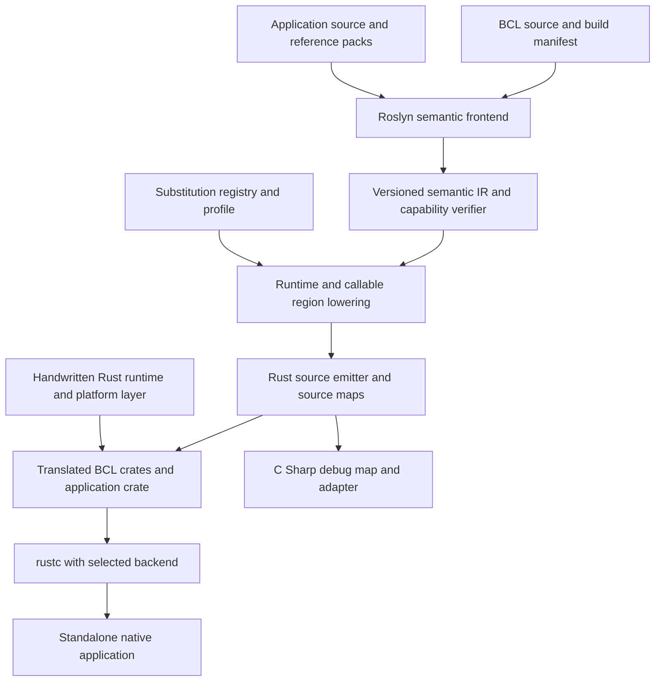
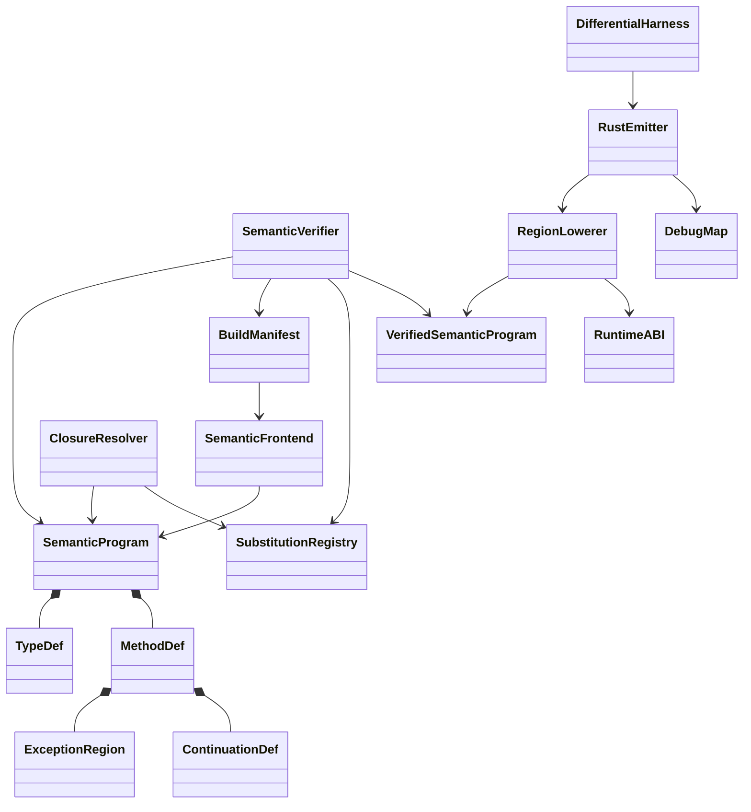

# C Sharp to Rust Semantic Transpilation

## An implementable architecture for translated base libraries and standalone native applications

Technical whitepaper | Version 1.6 | 10 November 2026

First draft with reviewed corrections and M0 proposals. Established answers and proposed design contracts are integrated into the main chapters; Appendix A retains unresolved questions. All nine architectural proposals remain NOT APPROVED. Technical resolution, owner approval and implementation acceptance are recorded separately.

## Executive assessment

This paper proposes a C# semantic transpiler that first translates a defined portion of the .NET base class library (BCL) into reusable Rust crates, then translates applications that reference those crates. A linked Rust compatibility runtime supplies object management, exceptions, type information, scheduling and platform services, allowing the generated native application to run without CoreCLR. The design preserves supported C# behavior through explicit runtime contracts; exclusive Rust ownership is introduced only where analysis establishes that it preserves that behavior.

The recommended architecture uses Roslyn for binding, a versioned semantic intermediate representation (SIR), a dependency-closed BCL translation pipeline, a small handwritten Rust bootstrap, and a substitution registry inspired by Cosmos plugs. It initially uses a nonmoving tracing heap and explicit managed references. It compiles generated Rust through rustc and LLVM. Cranelift is a separately qualified backend, with its own pinned toolchain and test matrix.

Exception handling uses a C# control-result type, methods split into callable regions, retained execution frames, separate handler search and cleanup, and explicit recovery continuations at both local and root boundaries. Invalid continuation or runtime invariant state produces a contextual fatal diagnostic. Rust checks generated Rust values and references, while a dedicated verifier checks C# exception control flow. Managed reachability, handle validity and collector invariants remain translator/runtime obligations. Neither checker alone proves semantic equivalence.

Debugging combines native symbols, C# source maps and an adapter that exposes logical managed frames in a compatible IDE. Existing CLR debugger engines require additional runtime integration. Compatibility with a selected .NET debugger engine is a separate acceptance gate, because symbols and editor language services alone do not establish that compatibility.

The practical first product is a source-backed, closed-world command-line application profile with a published API manifest. Whole-BCL compatibility, arbitrary binary NuGet input, runtime IL generation, unrestricted reflection, and a general CLR debugger bridge are not established capabilities. The roadmap contains explicit gates for expanding support without hiding these limits.

**M0 proposal status.** The main chapters contain documented answers, proposals, rationale and tradeoffs. Appendix A lists remaining choices and missing evidence; section 16.2 defines minimum real M0 prototypes separately from production acceptance. CoreLib binding, location soundness, two-pass recovery and actual .NET debugger-engine integration remain unproven. Appendix C specifies 43 proposed validation cases, all NOT RUN. Inclusion here approves no recommendation.

## Why

### Iterate rapidly in C#

The purpose of this project is to let developers iterate on application logic and capabilities in C#, then publish native applications through the Rust ecosystem with provable, explicitly scoped security properties. C# remains the primary language for expressing and changing application behavior. Translation makes the resulting application available to Rust's compiler, packaging and verification workflows.

The intended workflow uses C# to shorten the cycle of implementing, testing and revising application capabilities compared with writing those changes directly in Rust. The transpiler should preserve that advantage: developers should not have to redesign ordinary C# object relationships around Rust ownership rules or maintain a second application implementation. This is the project's motivating productivity hypothesis, not a measured claim that C# is universally faster to develop in. Representative change tasks must establish whether the complete workflow actually improves iteration time.

### Publish with demonstrable security guarantees

The release objective is **provably secure applications through the Rust ecosystem**, with each security claim stated as a property, a threat model, assumptions and supporting evidence. Rust compilation checks generated Rust values and references against Rust's type, ownership and lifetime rules. It does not prove the lifetimes or reachability of managed objects represented by handles. The translator and runtime must establish managed reachability, handle validity, aliasing and collector invariants. The translation pipeline adds obligations for semantic preservation, runtime safety, exception routing, recovery continuations and dependency closure. These obligations let release assurance be evaluated independently of the language used to author application logic.

Generating Rust and obtaining a successful build do not prove that an entire application is secure. In particular, the tracing heap, object handles and native interfaces require sound implementations; Rust's rules against undefined behavior also apply to unsafe code and across foreign-code boundaries. [S17] Memory safety does not by itself establish authorization correctness, secret protection, protocol correctness or resistance to resource exhaustion. A claim of formal proof requires an identified specification, proof method, checked result and stated trusted computing base. Differential tests, fuzzing and audits remain valuable verification evidence and must be labeled according to what they establish.

### Make the release claim reviewable

The proposed release workflow retains the C# source, generated Rust and source mappings, then binds the published binary to a pinned toolchain, dependency and substitution manifests, verification results and any property-specific proof artifacts. A security claim must cover its relevant translated BCL, compatibility runtime, unsafe code and native dependencies, or identify those components as explicit assumptions. Missing evidence blocks the corresponding assurance claim; successful Cargo packaging cannot substitute for it.

The project succeeds when it delivers both outcomes: faster application iteration in the intended C# workflow and native releases whose declared security properties can be independently checked. Iteration measurements should include editing, testing, translation and debugging. Release measurements should report which properties are statically enforced, dynamically checked, formally proven or still dependent on assumptions. The initial milestones build and verify the translation foundation; they do not establish a blanket application-security proof.

## 1 Evidence and terminology

**Documented fact** denotes a capability or rule described in an authoritative specification, vendor documentation, or the project's own source. A project README is authoritative about what its authors report, not independent certification of compatibility. **Proposed design** denotes a component or contract to implement here. **Inference** denotes an engineering conclusion drawn from those facts. All architecture and milestones in this paper are proposals unless explicitly identified otherwise.

Sources were consulted on 9 November 2026. Branch links are living references, not immutable implementation pins. At milestone M0, the implementation must resolve repository commits, dependency versions, licenses, reference packs, compiler options, and target profiles into a signed or hashed baseline manifest. The research establishes documented contracts and project-reported capabilities; it does not include independent builds or compatibility certification of those projects. Historical interface documentation is used only for the specific contracts cited, not as a current platform support matrix.

"Standalone" means no installed CoreCLR and no hidden CLR dependency in the application closure. The executable still includes this project's runtime and may depend on documented OS libraries. "Rust output" means emitted Rust source and Rust runtime crates; OS FFI and external native dependencies must be listed. It does not mean GC-free, entirely safe Rust, self-hosted compilation, or statically linked libc on every target. The Roslyn-based compiler itself initially runs on .NET during the build.

The reference environment is a pinned C# language version, .NET SDK/runtime and BCL source revision, OS, architecture, culture, timezone data, and feature configuration. Compatibility is claimed only for its supported profile. API surface coverage, test coverage, and behavioral compatibility are separate measures.

The M0 manifest also pins Roslyn packages, the accepted language feature set and relevant specification revisions. Ref fields/scoped references, static abstract interface members, inline arrays and newer Lock operand lowering require official versioned feature specifications alongside the stable language specification. Proposals contain historical and future discussion; accept only behavior supported by the chosen compiler baseline. An API documentation version is not a compiler-package pin. [S45][S47][S51][S52]

## 2 Existing implementations and permitted reuse

### 2.1 CoreLib and Native AOT

**Documented fact.** CoreLib defines fundamental types and is coupled to native CLR layouts and helpers. Microsoft documents FCall and QCall mechanisms, including GC-transition concerns. Native AOT compiles IL ahead of time, runs without an installed .NET runtime, includes runtime libraries, and constrains dynamic loading and code generation. [S01][S02]

**Inference.** These sources make the contracts inspectable. Reimplementing the contracts is more appropriate than reverse engineering an unknown binary. Native AOT is both an implementation reference and a useful secondary behavioral comparison, but its runtime is not a ready-made Rust crate. Linking its native runtime would be a different implementation variant with a different runtime and dependency claim. This proposal's baseline uses Rust replacements instead. [S07]

### 2.2 Cosmos plugs and generations

**Documented fact.** The Cosmos plug documentation describes replacing methods whose IL bodies are unavailable or inappropriate to the target, including internal calls and platform calls. Its historical examples refer to IL2CPU. The separately consulted gen3 README describes a NativeAOT kernel framework, x64 and ARM64, plugs, a collector, and exception handling. These are project-reported features, not a certification of all .NET APIs. [S04][S08]

**Proposed reuse.** Import plug signatures into a research inventory, recording generation, commit, target and license. Compare that inventory with the chosen BCL's actual call graph. Adapt individual algorithms only after review. Do not assume a Cosmos method name, layout, assembly version, or kernel implementation matches the selected hosted BCL. The reusable architectural idea is explicit, versioned replacement resolution.

### 2.3 bflat and ProtonOS

**Documented fact.** bflat separates a DotNet library based on its runtime fork from a minimal Zero library and documents x64/ARM64 UEFI only for Zero. ProtonOS reports a custom korlib, compacting GC, exception handling, reflection, dynamic assembly loading and a Tier 0 JIT; its README describes a custom korlib derived from zerolib and specifies `--stdlib:none` in the detailed build explanation. [S03][S05]

**Proposed reuse.** Study minimal bootstrap requirements and runtime service separation. ProtonOS's reported JIT and loader are informative, but implementing them is outside the initial closed-world native profile. No kernel, collector or debugger compatibility is inherited by translating similar C# source. Source reuse is subject to the file-level licensing and provenance policy in section 14.

### 2.4 Rust backend precedent

**Documented fact.** rustc normally uses LLVM and supports alternative backend work. Cranelift's consulted README documents nightly installation, a target matrix, partial SIMD support and limited panic unwinding. rustc_codegen_clr explicitly calls itself experimental. [S06][S09][S10]

**Proposed decision.** Emit ordinary Rust rather than depend on rustc private MIR APIs. Qualify the complete runtime, generated code and dependencies per backend. An upstream target's existence does not certify this compiler's platform support. CLR-backend experiments must use a separately demonstrated bridge and are not on the critical path.

## 3 Product profiles and semantic contract

### 3.1 Compatibility profiles

| Profile | Included objective | Explicit boundary |
| --- | --- | --- |
| P0 Bootstrap | Single-threaded primitives, UTF-16 strings, objects, one-dimensional arrays, basic exceptions and recovery | Internal development profile; no claim of application readiness |
| P1 Native CLI | Dependency-closed collections, delegates, bounded generics, synchronous console/file subset and explicit catch recovery | Closed world; invariant culture; source-backed dependencies; no arbitrary unsafe application code |
| P2 Hosted concurrency | Qualified Task/await subset, monitors, atomics, cancellation, bounded reflection and debug adapter | Runtime qualified at M5, tooling at M6; synchronization-context and execution-context behavior must be declared |
| P3 Expansion | More BCL APIs, cultures, platforms, native interop and additional debugger engines | Each capability needs an acceptance suite and platform qualification |

These profiles define delivery sequence, not existing support. Application references to excluded APIs fail with a source location and dependency path. A dynamic feature whose reachability cannot be bounded is rejected rather than silently compiled away. An optional API stub is permitted only for a genuinely unreachable member and cannot count toward supported API coverage.

### 3.2 What equivalence means

For a program accepted under profile P and an environment E, compare observable traces of original C# execution and generated native execution: return values, output, externally visible state changes, exception types and routing, explicit disposal, object identity relations, and supported metadata queries. Preserve C# evaluation order and exception timing at observable boundaries. Do not equate formatted exception prose, native addresses or randomized hash values across implementations. [S11][S13]

Deterministic tests require equal normalized traces. Nondeterministic tests require results consistent with the specified contract and controlled schedule, not identical wall-clock behavior. Collector timing and resource exhaustion are not bit-for-bit promises. Liveness and weak-reference tests use a declared root/liveness policy. Unsupported native faults, resource exhaustion and process-fatal operations have explicit dispositions. This is bounded semantic compatibility, not a proof of whole-language equivalence.

User-visible changes to termination policy, culture, scheduling or reflection retention must be declared in the profile. A root recovery policy is part of the compilation contract. A compiler cannot silently convert an unhandled exception into success or silently turn a source catch-and-continue path into process termination.

## 4 Architecture and build products

Figure 1 shows two production pipelines sharing one semantic ABI. The BCL pipeline runs first and publishes reusable Rust source crates plus metadata. Application translation consumes those artifacts and the matching .NET reference metadata. Final generic closure and link analysis still occur per application.



**Figure 1. Proposed component architecture.** Both source families use the same symbol identity and runtime ABI. The runtime supplies services, not an installed CLR.

### 4.1 Pipeline contracts

1. **Build capture:** restore a locked project graph; collect actual compiler inputs, generated sources, reference assemblies, preprocessor symbols, unsafe settings and platform alternatives. Reproduce upstream source generation rather than globbing all `.cs` files.
2. **Semantic frontend:** obtain compilations, symbols, `IOperation` and control-flow graphs. Resolve overloads, conversions, extension calls and checked contexts before Rust emission. Retain syntax for constructs that need custom lowering. Roslyn's public operation/CFG APIs are inputs, not a fully lowered CLR execution model. [S14][S15][S16]
3. **SIR construction:** persist typed operations, explicit locations, calls, exception regions, evaluation sequence and source spans. Validate it independently of Roslyn's in-memory objects.
4. **Closure and substitutions:** resolve every reachable body to translated source, a handwritten intrinsic, a platform replacement, or a rejection. Report the predecessor path for every unresolved edge.
5. **Rust lowering:** introduce object handles, callable regions, roots and continuation records. Emit deterministic symbols, Rust source and C# debug maps.
6. **Package and qualify:** compile the application closure, run differential suites, inspect linked dependencies, publish compatibility and provenance manifests.

### 4.2 Identity and cache keys

Use an assembly identity, logical core-universe ID, metadata namespace and nesting, generic arity, member kind, signature, parameter modes, custom modifiers and constructed type arguments for canonical identities. Normalize forwarded reference types to their implementation definitions through explicit forwarding records. Never identify `List<T>` by text alone or use Rust `TypeId` as a serialized .NET identity.

A BCL package key includes source commit and file hashes, SDK and reference-pack identities, Roslyn version, profile, target layout, SIR schema, substitution-registry hash, runtime ABI and emitter version. A changed key invalidates affected crates and mappings. Release crates as source for reuse; rustc compiled artifacts are toolchain-specific caches. Export generic templates in Rust source or retained SIR so application instantiations are available later.

## 5 Bootstrapping CoreLib before translating applications

**Documented fact.** CoreLib cannot be treated as an ordinary consumer of itself. It defines the core type system and has runtime-specific managed/native coupling. The physical source project contains runtime-specific decisions, so an application reference pack alone does not reproduce its build. [S01]

### 5.1 Separate compilation universes

**Proposed algorithm.** First capture and reproduce the selected upstream CoreLib compiler invocation, including generated inputs, special core-library settings, reference exclusions and platform/runtime flavor. Resolve special types from that compilation. Use a separate ordinary reference-pack universe to bind applications and non-CoreLib library projects. A bridge table relates reference-pack symbols, forwarders and implementation definitions. Do not load a duplicate `System.Object` from a normal reference pack into the CoreLib defining compilation.

Roslyn must bind each chosen body without unresolved symbols. Build-only declarations may be needed to represent unavailable native/intrinsic entry points, but they have no implementation status. Their call edges must resolve through the substitution registry. Reproducing the CoreLib build is an M0 spike; the paper does not assume an off-the-shelf `MSBuildWorkspace` invocation succeeds for every runtime source project.

**Proposed M0-CORELIB: shared source with Native AOT managed CoreLib files.** Start with one coherent .NET 10 servicing snapshot, initially runtime tag v10.0.14 and SDK 10.0.403. Capture the evaluated build, generated inputs, resolved commits and archive hashes before ratification. Translate shared managed algorithms and the selected Native AOT-specific managed files through this project's Rust runtime; do not link the Native AOT execution runtime to claim a Rust implementation. These candidates come from the inspected release metadata and project source. [S55][S56]

**Established source constraint.** Native AOT's managed files still use native Rhp/context, compiler-generated helper and layout contracts; they are not a portable CLR substitute. CoreCLR-specific files remain useful comparison evidence. An arbitrary file-by-file mixture needs a coherent manifest and reviewed adapter. [S57][S58][S59]

**Feasibility UNKNOWN.** The CoreLib binding run, symbol bridge and complete reachable-helper inventory have not been demonstrated. Section 5.4 gives the proposal; Appendix A.1 lists the remaining investigation.

### 5.2 Handwritten seed and staged translation

Create `csrt-types` and `csrt-core` first: primitive layouts, null and object handles, type descriptors, allocation/root APIs, UTF-16 storage, arrays, default values, exception allocation and dispatch. This handwritten seed breaks the circular dependence between translated exception and collection code and the runtime that executes it. Track its implementation and provenance separately from translated BCL methods.

Collections are translated as dependency closures. List, Dictionary and their comparers require foundational object, array, type and runtime behavior; a namespace or source-file count is therefore an unsuitable unit of bootstrap progress. Freeze and qualify each closure before expanding its API surface.

Then classify reachable CoreLib methods: **translate**, **replace**, **omit as unreachable**, or **reject**. Treat strongly connected dependency groups as units. Translate managed algorithms that do not depend on unsupported layout assumptions. Replace compiler-recognized primitive definitions, runtime intrinsics, native bodies and unsafe memory operations explicitly. Some intrinsics have source bodies that are placeholders or require compiler recognition; the presence of a body is not proof it can be translated literally.

The first published closure should include object identity, string length/indexing/ordinal equality, integer operations, array checks, generic equality primitives, `List<int>`, declared portions of `Dictionary<string,int>` and `Dictionary<int,string>`, and user-defined value-key lookup. Exact member inventories are frozen in M0, before numerical coverage claims. If a needed comparer or exception constructor expands the closure, that expansion is visible in the manifest and gate scope.

The BCL Rust crates are built and qualified before application translation is supported. Small source fixtures validate compiler and runtime contracts during bootstrap; application qualification then exercises the published BCL crates as dependencies.

### 5.3 CoreLib helper closure and scalar baseline

**Documented dependency.** Current Dictionary source contains Unsafe-based location helpers. String ordinal equality calls SpanHelpers.SequenceEqual, which contains guarded vector paths and scalar unsafe operations. These current-branch examples establish obligations to classify; they do not select a production revision or prove every helper is reachable from every application. [S42][S43][S44]

**Proposed M0-LOCATIONS, pending approval.** Accept the ref/scoped/span/stackalloc/inline-array forms required by the frozen closure and start with scalar implementations. Enumerate the exact forms and reachable Unsafe/MemoryMarshal and vector operations before freezing P1. Each helper needs a reviewed lowering or substitution with bounds, alignment, overlap, root/pin and exception contracts. Unsupported reachable helpers block publication. A source body or Intrinsic attribute is not an implementation.

Propose a scalar-first BCL path, subject to M0 ratification. Acceleration guards may be constant-folded only under the declared capability contract. Remaining vector types/count properties, unguarded intrinsics and scalar unsafe helpers still need dispositions. Application-visible capability probes must agree with the profile. A Rust backend may vectorize scalar output without exposing a managed SIMD API.

Before M3, compare string equality for short/long inputs, empty values, differing positions, aliased inputs and odd tails, and qualify pointer-width-dependent helpers per target. Every retained edge must resolve. Application SIMD expansion in section 10.4 is separate from these foundational BCL substitutions.

### 5.4 CoreLib source rationale and proposed contract

**Packet:** M0-CORELIB: Starting .NET library source. Version 1.6. Owner: project owner; approval record: none. Status: PROPOSED, NOT APPROVED. Approval: PENDING for M0; prototype evidence: NOT SUPPLIED.

**Proposed M0 decision:** Use the shared managed .NET library source with the Native AOT-specific managed CoreLib files from one .NET 10 servicing snapshot. Replace their runtime contracts with this project's Rust runtime. Start the feasibility build with runtime source tag v10.0.14 and SDK 10.0.403; freeze resolved commits, archive hashes and evaluated build inputs before approval. This is a candidate baseline, not an already reproduced build.

**Documented evidence:** The retrieved release metadata lists .NET 10 as active LTS and identifies runtime 10.0.14 and SDK 10.0.403. The Native AOT CoreLib project imports shared CoreLib source and includes runtime-specific files. Its ValueType implementation uses a compiler-supplied field helper and runtime type/layout information. The corresponding CoreCLR file includes native QCall dependencies. Native AOT exception code still relies on native Rhp/context contracts. These are concrete replacement obligations, not evidence of a portable runtime already written in C#. [S55]; [S56]; [S57]; [S58]; [S59]

**Reason for the proposal:** Native AOT-flavored managed files are the more useful starting point for a closed-program compiler because some operations are already expressed through compiler-generated helpers. Shared collection, string and numeric code should be translated where its reachable dependency closure is supported. The compiler must not link the Native AOT execution runtime merely to claim a Rust implementation. CoreCLR remains the primary behavior oracle for source-equivalence tests. This preference is an engineering inference from the inspected files; a binding and helper-closure prototype must establish feasibility.

**Proposed implementation contract:**

- Evaluate the selected upstream build to capture source lists, conditional symbols, generated sources, resources, target framework and exact reference assemblies. Roslyn binds that coherent compilation, not a directory of disconnected .cs files.
- Maintain a symbol bridge from the source CoreLib type identity to the reference-pack identity used by applications. Record origin and replacement for every reachable member, intrinsic, internal call, FCall, QCall and imported native function. Unresolved edges block acceptance.
- Use a small handwritten Rust seed for object/type handles, roots, locations, allocation and exception transport. Translate a frozen set including primitive arithmetic, string equality, List<int>, Dictionary<int,string> and value-key lookup against it.
- Retain upstream notices and a source/patch manifest. The inspected runtime license is MIT; dependencies, generated assets and native libraries require their own inventory. No blanket claim that every .NET asset has the same terms.

**Tradeoffs and alternatives:**

- CoreCLR-specific managed files provide the closest source match to the oracle but expose runtime layout and native services that would still require replacement.
- Native AOT-specific files offer useful closed-world examples but also compiler/runtime hooks. They do not supply a drop-in CLR substitute or automatically preserve CoreCLR implementation details.
- An arbitrary file-by-file mixture can reduce one local dependency while creating incompatible assumptions elsewhere. Allow a mix only through a documented adapter and a new coherent build manifest.
- Reimplementing the entire BCL avoids upstream bootstrap complexity but increases semantic and maintenance work. Use targeted substitutions where justified, preserving managed source provenance elsewhere.

The unresolved investigation and its evidence request are recorded in Appendix A.1. Proposed validation case details remain in Appendix C.

## 6 Semantic IR and compiler component model

### 6.1 SIR schema

The initial schema contains `AssemblyDef`, `TypeDef`, `MethodDef`, `FieldDef`, `TypeRef`, `Place`, `BasicBlock`, `Operation`, `ExceptionRegion`, `ContinuationDef` and `SourceSpan`. A `Place` is a storage location, not a copied value. Operations distinguish field load/store, element load/store, boxing, unboxing, cast, constrained call, virtual/interface call, initialization, checked arithmetic, managed byref and native FFI.

Place/type records also carry storage provenance, stack-only status, lexical/escape scope, owner/root requirements and mutability restrictions. Keep stack storage distinct from managed heap locations. Static interface calls carry an interface slot, closed receiver type and constraints; iterator bodies carry suspension/disposal state separately from async await state.

Each operation records effects such as `may_allocate`, `may_throw`, `may_call_managed`, `may_suspend` and `may_enter_native`. Effects are conservative summaries, not C# checked exception declarations. Any method may have an escape edge to its caller. Implicit exceptions from null checks, overflow, indexing, allocation and type initialization participate in the graph.



**Figure 2. Proposed compiler class model.** Composition records durable definitions. SemanticVerifier checks the program against the build/capability manifest and substitutions, then produces the verified-program gate consumed by RegionLowerer. RuntimeABI validation and post-lowering checks remain required before emission.

### 6.2 Verifiers and diagnostics

Verify type consistency, complete substitutions, explicit exceptional successors, legal region nesting, initialized frame slots, rooted handles at safepoints, and continuation/frame compatibility. Reject a transfer into a dead lexical region or across an invalid async/byref lifetime. Every diagnostic includes C# source coordinates, symbol identity, violated contract and a transitive dependency path where relevant.

Before lowering, SemanticVerifier requires bound, dependency-closed SIR whose capabilities and helper dispositions match the manifest. It produces VerifiedSemanticProgram or diagnostics; emission cannot accept an unverified program. After lowering, check that introduced roots, helper effects, cleanup routes and continuation signatures preserve those invariants. Enforce both gates through interfaces and rejection tests, not only a diagram.

Emit a closed control enum and exhaustive dispatch matches without wildcard arms. Rust then catches missing cases, incompatible return types and some invalid borrow/lifetime relationships. It cannot prove that C# filters execute in the right order, that every GC root is reported, or that an arbitrary numeric continuation ID denotes a live frame. Those are explicit verifier and runtime responsibilities. The absence of a local C# catch is valid and cannot itself become a compiler error.

## 7 Object model and Rust ownership

### 7.1 Shared identity and managed locations

**Documented fact.** C# reference assignments can alias the same mutable object, while value assignments copy values; byref parameters refer to storage. Rust's aliasing and data-race constraints still apply inside unsafe code. [S13][S17]

**Proposed representation.** A nullable `ObjRef<T>` is a non-owning, typed handle into a runtime heap. A separate `Root<T>` or explicit frame slot retains reachability. Handles contain an object index and generation; the heap table maps them to allocation and type descriptors. Equality of references uses stable object identity. Runtime identity hashing is stable for an object's lifetime but is independent of value equality and physical address.

Generated field operations copy values through checked location APIs. They do not hand out long-lived `&mut T` references to freely aliased C# objects. Store GC-managed references as handle values. A `ManagedPlace<T>` identifies a frame slot, static slot, field or array element plus owner/root information; it supports `ref`, `out`, `in` and aliasing. Interior byrefs keep their owner alive. A copied struct copies its value fields and handle values, not the objects referenced by those fields. Mutable struct receivers need a location, not an accidental temporary copy.

For P0/P1 use a single managed execution thread with short internal borrow windows. No borrow or internal lock may remain held across a managed callback, exception filter, allocation or suspension. P2 uses reviewed synchronized or atomic storage operations and a declared memory-model subset. It must never lower racing C# accesses to Rust data races. General race compatibility is not established merely by adding `UnsafeCell`; data races remain undefined behavior in Rust. [S17]

### 7.1.1 Stack-only values, spans and native memory helpers

**Proposed M0-LOCATIONS, pending approval.** Classify Span<T>, ReadOnlySpan<T>, ref structs, ref fields, scoped references and stackalloc under the pinned language version. They are not ordinary heap objects. A span-like value needs an accepted location/range representation, valid owner or stack scope, length and escape rules. Retained inline arrays also require a storage/layout and element-access contract. [S45][S51]

Retain mutable aliases as checked locations or bounded access operations, rather than exposing simultaneous unrestricted Rust mutable references. Reject escaped stack locations, prohibited boxing/capture/suspension and unresolved helpers with original source coordinates and a dependency path. Do not hold a Rust borrow across callbacks, allocation or suspension. Interior managed locations retain their owners under the root protocol.

Qualify slices, zero length, overlapping copies, alignment, nested byrefs, callbacks, collection during access and invalid escapes. Unsafe/MemoryMarshal replacements have explicit preconditions and reviewed implementations in the registry. Native pointers need their own provenance/lifetime and pin/root contracts. M0 freezes the exact subset; unresolved reachable operations cannot pass M3.

**Proposed M0-LOCATIONS contract.** Each location carries storage kind, owner/root or source frame, element type, offset/range, generation, access mode and source-lifetime limit. Retaining a frame during handler search cannot extend a stack location's source-visible lifetime. Zero-length and one-past locations may be described without creating or dereferencing invalid Rust references. Access uses short checked runtime operations. Explicit/overlapping layouts containing references require a separately verified representation or rejection.

Support required reviewed Unsafe helpers with element-versus-byte offsets preserved. For accepted MemoryMarshal.Cast calls, preserve managed rejection of reference-containing types and length overflow as catchable failures; enforce the documented alignment contract. Reject unmodeled reinterpretation and arbitrary integer-to-pointer conversion. Use fallible bounded managed allocation where OutOfMemoryException is promised. At M5, synchronized storage or a proven atomic representation must keep even supported unsynchronized C# accesses from becoming Rust data races. Exact supported forms, capability probes and safe API soundness remain **OPEN for M0**. [S61][S62][S63][S17]

### 7.2 Heap and collector contract

Use a precise, stop-the-world, nonmoving mark-and-sweep collector first. Emit root slots for live locals, arguments, pending exceptions, frame temporaries, generic dictionaries and suspended tasks. Trace static fields, delegate targets, continuations and registered native handles. Allocation and loop/call safepoints invoke collection only under the documented root protocol. Zero-initialize storage before running a constructor and keep the partly initialized object rooted.

Nonmoving storage simplifies locations and FFI, but does not excuse missing roots. P2 adds a safepoint rendezvous for every managed thread and native transition states; it is a separate gate. Use generation checks to detect stale handles. Guard collector metadata with an audited unsafe boundary. Test cycles and stress collection at every eligible allocation. Microsoft's GC documentation is the behavioral reference for reachability concepts, not a requirement to copy its collector algorithm. [S18]

Weak references, finalization, resurrection and ephemerons require distinct reachability phases. Initially reject their application APIs and replace BCL dependencies only where equivalent behavior is established. Before enabling them, test short/long weak references, finalization queues, suppression and re-registration, resurrection and `KeepAlive`. Rust `Drop` is not a general implementation of C# finalizers. Explicit `Dispose` and `using` belong to control flow and are supported earlier.

### 7.3 Strings arrays and primitive values

Use immutable UTF-16 code-unit storage for `System.String`, including unpaired surrogates; `char` is a 16-bit unit, not Rust `char`. Keep null distinct from empty. Ordinal operations are independent of culture. Intern literal strings under the profile's rules. UTF-8 conversions are explicit. [S19]

Use array descriptors with element type and length, zero defaults, bounds checks and runtime store checks for reference covariance. Multidimensional and nonzero-lower-bound arrays are separate capabilities. Boxed values carry a type descriptor and copied payload; unboxing checks exact required type and supports interior locations where required. [S13][S20]

Lower checked and unchecked integer arithmetic explicitly rather than inherit Rust debug/release overflow behavior. Specify shift masking, casts, division edge cases, floating-point conversions, NaN behavior and pointer-sized integer width. Decimal, formatting and culture-sensitive algorithms require translated or separately validated implementations; they are not aliases for Rust floating point. Preserve exception ordering among receiver evaluation, arguments, dereference and stores. [S11]

### 7.4 Default struct equality and hashing

**Documented dependency.** CoreCLR ValueType.Equals uses reflected fields when its fast bit-comparison conditions do not hold; hashing also uses runtime type/layout information. Native AOT instead uses compiler-injected field helpers and runtime contracts. Excluding public reflection from P1 does not remove the equality/hash behavior needed by retained structs and collection keys. [S48][S49]

**Proposed M0-VALUETYPE, pending approval.** Emit type-specific equality/hash helper thunks for every retained struct. Keep ValueType.Equals, user overrides, IEquatable<T>, operator == and EqualityComparer<T>.Default as distinct dispatch paths. The default comparer can select IEquatable<T>; that does not redefine every boxed ValueType.Equals call. Retain internal type/field metadata without enabling unrestricted public reflection. [S57][S58][S66][S67] Define nested structs, reference fields, floating-point equality, NaN and signed zero. Do not compare padding bytes indiscriminately. Runtime-provided equality/hash implementations must give equal keys equal hashes under the selected algorithm. Preserve accepted user overrides and observable effects even when application code violates that contract; do not silently repair inconsistent hashes or mutated keys.

Use user structs as Dictionary keys, including nested, reference-field and floating-point cases. Numeric hash comparisons follow section 3.2; randomized/cross-process values are not promised to match and any exposed hash-value policy must be explicit. M0 is asked to approve per-type thunks and freeze the retained type denominator. Default runtime hash numbers follow the declared normalization policy; user-defined deterministic hash behavior remains observable and is not normalized away. Helpers can call managed code that allocates or throws, so they participate in roots and control results. Feasibility of the complete helper closure remains unproven; M2 runtime tests and M3/M4 collection fixtures qualify it. [S68]

### 7.5 Checked-location rationale and proposed contract

**Packet:** M0-LOCATIONS: Memory access in the first release. Version 1.6. Owner: project owner; approval record: none. Status: PROPOSED, NOT APPROVED. Approval: PENDING for M0; prototype evidence: NOT SUPPLIED.

**Proposed M0 decision:** Represent C# references and spans as checked descriptions of storage, rather than long-lived Rust references. Support the ref/scoped/span/stackalloc/inline-array forms needed by the frozen library and application set. Begin with scalar implementations. Keep arbitrary application pointer code and unreviewed Unsafe/MemoryMarshal operations outside the accepted subset.

**Documented evidence:** C# reference-safety and inline-array feature specifications impose lifetime/escape restrictions. The selected SpanHelpers source contains Unsafe-based scalar access as well as vector branches. Unsafe.Add uses element-relative offsets; MemoryMarshal.Cast has restrictions involving reference-containing types, length and alignment. Rust references impose aliasing and validity obligations that an aliased C# location cannot simply inherit. [S45]; [S51]; [S61]; [S62]; [S63]; [S17]

**Reason for the proposal:** A location should identify its storage owner, byte or field range, type/layout, mutability and lifetime generation. The owner may be a heap object, static region or retained method frame. A view retains its owner's root where necessary. Runtime operations validate and access storage in short steps; a Rust borrow must not survive a managed call, safepoint or callback that can invalidate its assumptions. Bounds-correct C# aliases must remain usable, including overlapping writable spans. A borrow checker error in a naive lowering is a compiler defect to fix, not permission to reject otherwise supported C#.

**Proposed implementation contract:**

- Initially accept ref/in/out parameters, ref locals/returns and scoped forms when Roslyn permits them and the SemanticVerifier proves the declared storage outlives every use. Preserve readonly access and copy behavior. Carry the proof through callable-region boundaries.
- Accept arrays and strings as appropriate span backing stores, slicing, indexing, copying and required inline arrays. Stackalloc is limited to unmanaged element types and storage bounded by the source method frame. Retaining a frame for handler search must not extend the source-visible lifetime.
- Register reviewed equivalents for required Unsafe.Add/AddByteOffset, raw-data access and unaligned reads/writes, and required MemoryMarshal operations. Preserve element versus byte units. For accepted MemoryMarshal.Cast calls, preserve its managed rejection of reference-containing types and its length checks. Reject unmodeled reinterpretation and arbitrary integer-to-pointer conversion before native emission.
- For scalar profiles, report acceleration probes as false only for APIs the profile actually implements. Supply required scalar bodies and compile-time vector members used by the reachable code. A false probe alone does not make all vector type references disappear.
- Do not manufacture references to null, one-past or zero-length storage. Model such locations without dereferencing. Validate at access, preserve documented managed errors, and treat impossible stale internal capabilities as runtime faults.
- Use fallible, bounded managed allocation paths where an OutOfMemoryException is supported. Do not read uninitialized storage into Rust values. Stackalloc tests compare written elements; unspecified source bytes are not an oracle.
- At M5, ordinary managed reads/writes must use synchronized runtime access or a proven safe atomic representation, including source programs with unsynchronized field access. Safe C# races must not become Rust data races. Preserve the source memory-model guarantees and permitted outcomes; release runtime access guards before callbacks that can re-enter the same storage.

**Tradeoffs and alternatives:**

- Direct Rust slices and references are faster and idiomatic where non-aliasing is proven, but a universal mapping would strengthen C#'s aliasing rules incorrectly.
- Checked descriptors introduce checks and may inhibit optimization. They give one reviewable representation for heap movement, frame lifetime, callbacks and recovery.
- A scalar first profile reduces hardware-specific obligations and can be optimized later. It still needs complete scalar helper closure and honest capability reporting.
- Rejecting all low-level library code would be simpler but would exclude ordinary strings and formatting dependencies. Reviewed substitutions are necessary even if unsafe application source is rejected.

The unresolved investigation and its evidence request are recorded in Appendix A.2. Proposed validation case details remain in Appendix C.

### 7.6 Value-comparison rationale and proposed contract

**Packet:** M0-VALUETYPE: Comparing values and finding dictionary keys. Version 1.6. Owner: project owner; approval record: none. Status: PROPOSED, NOT APPROVED. Approval: PENDING for M0; prototype evidence: NOT SUPPLIED.

**Proposed M0 decision:** Generate equality and hash helper functions for every retained struct, with separate call paths for ValueType.Equals, user overrides, IEquatable<T>, operators and EqualityComparer<T>.Default. Keep type/field information internal to the compiler/runtime. Do not require public reflection merely to support value-key lookup.

**Documented evidence:** The inspected CoreCLR ValueType implementation has layout-sensitive and field-based paths; Native AOT uses a compiler-supplied field helper. CoreCLR's comparer factory selects IEquatable<T> when applicable, with additional string, nullable and enum cases. Microsoft documents that default hash numbers need not match between implementations or processes, although equal values must have equal hashes. [S57]; [S58]; [S66]; [S68]

**Reason for the proposal:** Compiler-generated helpers make required value semantics available without implementing general runtime reflection first. They also avoid comparing padding or invalid raw Rust representations. However, a helper must model the actual C# entry point. A struct can implement IEquatable<T> without overriding object.Equals, so generic equality and boxed ValueType.Equals can deliberately differ.

**Proposed implementation contract:**

- Generate field-aware default ValueType.Equals behavior, including nested fields and reference-field virtual equality, and correctly dispatch user object.Equals/GetHashCode overrides. Handle enum and nullable comparers explicitly.
- Keep overloaded operator == separate from Equals. Use IEquatable<T> only on the paths that select it. Preserve null handling, exact value-type identity, boxing and side effects/exceptions from user code.
- Do not universally derive Rust Eq/Hash or memcmp C# struct storage. Floating-point NaN and signed zero, padding, explicit layouts and references require deliberate handling.
- Preserve user-defined deterministic hash computations exactly within the accepted subset. Permit default runtime hash numbers to differ under a declared comparison policy; compare equality/lookup properties rather than deleting arbitrary output differences.
- Keep runtime-provided identity hashes stable for their documented lifetime. Preserve the source's behavior if a user mutates a key or violates the Equals/GetHashCode contract; report or document it, but do not silently repair application logic.

**Tradeoffs and alternatives:**

- Generated helpers increase per-type code and require completeness across retained types, but fit a closed-world compiler and keep reflection optional.
- Metadata-driven generic comparison reduces duplicated code but needs field traversal, boxing and runtime dispatch machinery, potentially expanding the initial runtime.
- Raw byte comparison is fast only under proven restrictions. A general version would confuse padding, floating-point and reference semantics.
- Exact parity for all runtime-generated hash numbers would add unstable implementation coupling. A documented policy supports portable semantic behavior while making observable limitations explicit.

The unresolved investigation and its evidence request are recorded in Appendix A.5. Proposed validation case details remain in Appendix C.

## 8 C Sharp exceptions as explicit control results

### 8.1 Result transport and callable regions

**Documented fact.** C# has typed catches, filters, rethrow and finally. Filters may run before cleanup in a deeper call. A throwing filter is treated as a failed filter. [S12][S22]

**Proposed design.** Use `Result<T, ExceptionRef>` for leaf operations only when a verifier establishes that returning cannot discard observable locals, interior locations, roots or pending managed cleanup needed by an outer filter or handler. Use a custom control algebra for regions that participate in nonlocal exception processing. This is composition around Rust types, not inheritance from the standard `Result`. The ordinary bind operation is not allowed to perform cleanup before handler selection.

Split a managed method into generated Rust functions for body blocks, call-return points, filter bodies, catch bodies, finally bodies and normal continuation points. Each function takes an explicit frame capability and runtime context. Retained frames contain C# locals, evaluation temporaries, logical call site, current protected region and root slots. Defunctionalized continuation IDs and generated function tables avoid Rust closures that simultaneously borrow the same locals mutably. These functions are native compiled code; no CIL interpreter is required.

The following is an interface sketch, not a compiled runtime implementation:

```rust
enum RegionExit {
    Next(Continuation),
    Call(CallRequest),
    Return(ManagedValue),
    Throw(ExceptionPacket),
    Suspend(TaskToken),
    Fatal(RuntimeFault),
}

enum RootOutcome {
    Completed(ManagedValue),
    Recovered(RecoveryEntry),
    Escaped(ExceptionReport),
    Fatal(RuntimeFault),
}
```

`Throw` means search or propagate, not immediately destroy the frame. `Next` includes an ordinary handler's post-catch continuation. `Recovered` exposes the root's validated recovery entry to the Rust host; the host can re-enter the dispatcher in the same process. `Fatal` is not catchable by ordinary C# handlers. A `RecoveryEntry` is an opaque, single-use capability created by the dispatcher, not an arbitrary jump address.

### 8.2 Ordered exception resolution

1. At a throw, retain the exception object, throw site and active frame/region chain. Preserve the original exception identity for bare rethrow.
2. Search outward through eligible catches in source order, evaluating filters in retained frames before unwinding. Filter calls may allocate, mutate state or throw; a filter-thrown exception is resolved within the filter invocation and, if it escapes the filter, treated as filter failure while the original search resumes.
3. Select a handler and build the cleanup route for scopes being exited. Execute finally regions from innermost outward. The finally associated with the selected catch's own try is not part of this pre-catch route; it runs when control subsequently leaves that try/catch. A normal `return`, `break` or other scope exit uses the corresponding cleanup route without an exception search.
4. A cleanup invocation can handle its own exceptions locally. If a new exception escapes that cleanup, abandon the previous pending transfer and search from the new throw location through the applicable enclosing regions; discard the obsolete selected handler. A locally caught cleanup exception does not replace the original pending exception.
5. Enter the selected catch with its exception binding. On leaving the catch, execute its associated finally, if any, for both normal and exceptional transfers. A successful catch then reaches its generated successor, including continuing loops or returning normally. Keep all enclosing frames required by that successor.
6. If no source handler matches, route to the declared root policy. Do not manufacture a compile error because a method has no local catch.

Nested searches need a stack of search records. A filter can invoke code with its own handlers without overwriting the suspended outer search. Cleanup records carry state so that completed finally regions do not execute twice. Tail calls and direct Rust calls are optimizations only after proving their frame and exception effects can be elided.

### 8.3 Recoverable root entry point

Every entry from a Rust or native host into managed execution, every managed thread root and every task/scheduler boundary has an explicit root disposition. A task fault normally completes its task; it does not automatically become a process-fatal exception. Main's returned task is observed according to the application entry policy. Native callbacks return an error/status through the declared FFI contract; they never unwind a managed exception across an incompatible ABI.

Root recovery is a required capability. Register a root policy as a generated outer catch region or an explicit hosted contract. On successful recovery, the runtime returns `RootOutcome::Recovered` with a validated `RecoveryEntry`. The Rust entry point resumes that continuation with the surviving managed frame and roots. For a root wrapping an operation loop, that entry may be the loop header; for an ordinary catch it may be the statement following try/catch. Recovery can remain within the same long-running application and need not restart the process or replace the whole operation.

A handler does not by default resume the instruction that threw. It resumes the successor established by the source CFG or by the explicitly declared host recovery contract. Frames already exited by cleanup cannot be re-entered. Root recovery must not silently change an original application's unhandled-exception policy. The source can supply an enclosing catch; otherwise a recovery policy is an explicit product configuration. Microsoft's unhandled-exception notification is not evidence that arbitrary termination can be canceled. [S23]

Record the recovery policy identity in the build manifest and observation trace. Source catch-and-continue cases compare with the same source on CoreCLR. Configured host recovery compares with an equivalent CoreCLR host wrapper where feasible; otherwise it uses independently specified host-policy expectations and is labeled as an extension. Do not require configured recovery to match an unmodified CoreCLR process lacking the corresponding handler. Immediate handling and outward propagation remain valid under the declared contract.

**Proposed M0-RECOVERY, pending approval.** Configured host recovery wraps one operation in an explicit outer try/catch-equivalent loop. Host state is rooted outside the failed operation's lifetime. After handling, a one-use capability identifies a live frame generation, target region, required live-state shape and thread/operation identity. Re-enter the valid post-handler successor or loop header and process subsequent work in the same process. This is ordinary non-terminating recovery, not a process restart or resumption of the faulting instruction. Repeated recovery, handler failure, cleanup failure and stale capability rejection require the same assertions in the source and configured-host oracle lanes. The retained-frame and cleanup protocol remains **Feasibility UNKNOWN** until demonstrated.

### 8.4 Lifetime validation and fatal context

Before resuming, validate runtime-instance and frame generations, continuation signature, region ancestry, required slot initialization, root registration, cleanup epoch, active lease/pin state and thread-affinity constraints. A statically rejected transition is a compiler diagnostic. A dynamically invalid transition yields `Fatal`, preserving the original managed exception as causal context.

A managed exception should not corrupt Rust ownership. An invalid lifetime or ownership state indicates a compiler/runtime defect, invalid interop, or an invalid recovery capability. Do not dereference questionable state to create a richer error. Maintain a bounded, preallocated diagnostic record as execution proceeds. The required report includes build/runtime/ABI/backend IDs; exception type and inner causes; original throw/rethrow sites; logical C# and generated Rust frames; handler search decisions; completed and pending cleanup; attempted continuation; frame generations and root/lease validation; exact rejected invariant; and final exit status. Mark any unavailable field with a reason instead of fabricating it.

**Proposed default-host exit convention, not an approved platform rule.** Preserve explicit application exit requests and Main results. Use status 1 for an unhandled managed failure and request status 70 for a detected RuntimeFault reaching the controlled fatal exit path. Status 71 is not selected. Record typed categories ApplicationExit, UnhandledManagedException and RuntimeFault, plus both requested status and platform-observed status. Application code can itself request 1 or 70; a number alone never identifies the cause. Panic abort may yield a platform signal/status instead of 70. These are proposed host defaults, not universal .NET or POSIX meanings; exact CoreCLR-unhandled exit parity would need a separately approved policy.

Write human-readable stderr plus versioned JSON. Use a minimal nonallocating fallback if normal formatting fails. Stop managed execution immediately on `Fatal`; best-effort diagnostic output cannot guarantee recovery from arbitrary memory corruption.

Rust panic containment is separate. `catch_unwind` catches unwinding panics, not aborts, and is not a general C# try/catch mechanism. The baseline managed exception machinery does not require Rust panic unwinding, which also helps Cranelift qualification. CoreCLR's internal-exception design is background for separating runtime failures from managed exception transport, not the source of C# handler ordering. [S24][S10][S21]

**Proposed M0-PANIC: panic=abort in production and normal debug applications, pending approval.** Pin the effective mode for each qualified backend and crate graph. Rust test-harness unwinding does not qualify a differently built production application. Do not select immediate-abort behavior where the diagnostic hook is part of the contract. A panic hook can emit bounded pre-recorded context, but cannot promise complete reporting. Supported C# bounds, overflow and conversion failures must be checked and transported as managed control results before Rust would panic. Where managed allocation failure is supported, use reviewed fallible allocation; hidden infallible standard-library allocations and OOM aborts remain explicit limits. [S53][S69][S70]

**Established limit.** Arbitrary corruption, stack exhaustion, abort and external kill can prevent full context or the requested exit status. A result wrapper does not make actual Rust undefined behavior recoverable. Unwinding, if later proposed, needs a separate containment/cleanup contract.

**Missing feasibility evidence.** Debug/release managed recovery and controlled fatal reporting under the proposed settings have not been demonstrated. Appendix A.6 requests the child-process probes; section 16.2 defines their M0 scope.

### 8.5 Panic rationale and proposed contract

**Packet:** M0-PANIC: Unexpected failure inside Rust. Version 1.6. Owner: project owner; approval record: none. Status: PROPOSED, NOT APPROVED. Approval: PENDING for M0; prototype evidence: NOT SUPPLIED.

**Proposed M0 decision:** Use panic=abort for generated production applications and their normal debug builds on the initially qualified backends. Transport supported C# exceptions through explicit managed control results. A Rust panic or detected runtime invariant failure is a fatal internal fault, not a recoverable C# exception.

**Documented evidence:** Rust defines abort and unwind panic modes; ordinary abort still permits a panic hook, whereas immediate-abort skips hooks. Rust overflow checks can panic. The std allocation-error handler normally aborts. Cranelift's backend documentation currently describes experimental and platform-limited unwinding with abort enabled by default. None of these mechanisms supplies C# exception semantics. [S53]; [S69]; [S70]; [S76]

**Reason for the proposal:** Keeping managed exceptions separate from Rust panic behavior makes non-terminating C# recovery independent of native unwinding support. Aborting on an internal defect avoids promising safe recovery from an unverified state. It also reduces backend-specific unwind dependencies. It does not prove runtime soundness, and aborting after UB is not a reliable containment strategy.

**Proposed implementation contract:**

- Set panic=abort in the generated executable's dev/release profiles and verify effective compiler flags across the graph. Do not select immediate-abort if panic-hook reporting is required. Rust test harnesses may use a separate unwind configuration; their success does not qualify production panic behavior.
- Lower supported null, bounds, division, conversion and checked-overflow failures explicitly to managed exception values. Avoid unwrap/expect and implicit panic paths for conditions the C# program can catch.
- Create a fatal-report path for detected invalid handles, impossible continuation states and broken runtime invariants. Use preallocated context, bounded formatting and a reentrancy guard; avoid calling arbitrary managed code or taking locks that may already be held.
- Record source method/location when known, original managed exception and handler/cleanup path when relevant, build/profile/backend identifiers, invariant name and the last valid continuation. Report only context that remains reliable.
- Use fallible allocation at managed allocation seams if catchable OutOfMemoryException is promised. Hidden infallible Rust/runtime allocations, stack exhaustion, OS termination and arbitrary memory corruption remain explicit limits.
- Never unwind across a native ABI that does not permit it. Foreign callbacks require a reviewed status/result translation contract. Rust ownership violations rejected at compile time are transpiler errors; they are not runtime exceptions that can be caught.

**Tradeoffs and alternatives:**

- Unwind can run Rust cleanup and makes some test harnesses convenient, but does not implement C# filter ordering and cannot make unsound state recoverable.
- Abort loses Rust stack cleanup and may limit crash reporting. C# finally/using obligations for ordinary managed exceptions still run through the explicit managed protocol before any successful recovery.
- A hook with rich allocation-heavy formatting is easier to write but unreliable exactly when memory or locks are compromised. A minimal bounded report is the safer baseline.
- Treating every panic as a managed exception appears convenient but conflates implementation defects with supported source behavior and would create false recovery guarantees.

The unresolved investigation and its evidence request are recorded in Appendix A.6. Proposed validation case details remain in Appendix C.

### 8.6 Recovery rationale and proposed contract

**Packet:** M0-RECOVERY: Continuing after a handled exception. Version 1.6. Owner: project owner; approval record: none. Status: PROPOSED, NOT APPROVED. Approval: PENDING for M0; prototype evidence: NOT SUPPLIED.

**Proposed M0 decision:** Use retained managed frames and a two-stage handler-search/cleanup protocol. Add an explicit outer operation loop for configured host recovery. A recovered operation returns control to an approved post-handler continuation or the next operation in that loop, in the same process. Never resume the faulting instruction or a frame whose source lifetime has ended.

**Documented evidence:** C# specifies lexical handler matching, outward propagation, filter evaluation and finally behavior. Its example demonstrates an outer filter before an inner finally and then the catch body. A filter exception acts as a false result; a new exception escaping finally replaces the pending exception. Native AOT's implementation still requires native execution machinery, so it cannot simply be transplanted as this protocol. [S12]; [S59]

**Reason for the proposal:** Callable Rust regions are useful only if their saved managed frames remain available while outer filters inspect source-visible state. A plain chain of Result returns that has already destroyed frames and run cleanup cannot reproduce that behavior. The proposed managed control result must retain exception identity, search position, active regions and a legal continuation. Composition with Rust Result is feasible as a design, but it is not inheritance from Result, and ordinary ? propagation alone is insufficient.

**Proposed implementation contract:**

- Represent normal return and managed throw separately from internal RuntimeFault. Search handlers in source order while required frames and roots are retained. Once a handler is selected, run intervening cleanup in the correct order, then enter that handler.
- Support normal catch completion, return, break/continue where legal, rethrow and a new throw. Revalidate exception routing after cleanup itself throws. Never convert an escaping exception to a compile error merely because the current method has no catch.
- For source-written catches, emit their original control flow. For configured outer recovery, generate an explicit wrapper equivalent to an outer C# try/catch around one operation. Keep host state in roots outside the failed operation's lifetime. The handler may return a handled outcome that lets the loop run again.
- Use an opaque one-use continuation capability carrying frame generation, target region, live-state shape and thread/operation identity. Validate it before transfer. It cannot resurrect stackalloc storage or byrefs whose source lifetime ended.
- Specify source-equivalence and host-policy test lanes separately. Compare source catches with the same CoreCLR source. Compare configured recovery with an equivalent reference wrapper or independently specified traces, rather than claiming it was present in the original application.
- Recommend a declared default-host convention: preserve explicit application exit requests and Main results, use status 1 for an unhandled managed failure, and request status 70 for a detected runtime fault that reaches the controlled fatal exit path. Retain typed categories ApplicationExit, UnhandledManagedException and RuntimeFault in diagnostics. These numbers are a proposed host convention, not universal .NET/POSIX meanings; 71 is not selected.
- Record both requested application/host status and the platform-observed status. A panic abort may produce a platform-specific signal/status instead of 70. An application can itself request 1 or 70, so status alone never identifies the cause. Exact platform CoreCLR-unhandled exit parity would require a different, explicitly approved policy.

**Tradeoffs and alternatives:**

- Retaining frames and running a search pass preserves observable filters and locals but increases implementation and memory-accounting complexity.
- Immediate outward Result propagation is simpler but is only valid after proving no later handler/filter needs the discarded state and no cleanup ordering changes.
- A restart-the-process supervisor can improve availability but does not satisfy the required non-terminating recovery in one process. It is an optional operational layer.
- A configurable host handler adds explicit behavior beyond the original source. Requiring an equivalent reference wrapper makes that extension testable without mislabeling it as unchanged source behavior.

**Established boundary.** Managed exceptions do not normally corrupt Rust ownership. Invalid lifetime state indicates a lowering/runtime defect, invalid interop or unsupported unsafe behavior. If continuation validity cannot be established, terminate with reliable available context; catch does not repair Rust UB.

The unresolved investigation and its evidence request are recorded in Appendix A.7. Proposed validation case details remain in Appendix C.

## 9 Generics dispatch and initialization

### 9.1 Reified types and finite code closure

**Proposed design.** Represent closed managed types with stable descriptors containing definition identity, generic arguments, base type, interfaces, layout and operation tables. Rust monomorphization is an implementation tool, not a substitute for .NET type identity. Distinct constructed types remain distinct even if machine code is shared. Static storage and initialization state are per closed type. [S13][S25]

Initially specialize a finite reachable set of constructed methods and types. Compute a fixed point from direct calls, virtual/interface implementations, delegate creation, metadata roots and permitted reflection constructors. Generic virtual methods need explicit per-instantiation dispatch entries or dictionaries. Map constrained calls so that value-type receivers are not accidentally boxed or copied. Handle interface variance through managed assignability checks and adapter thunks, not an assumed equivalence to Rust trait objects.

Include static abstract and supported static virtual interface slots in binding, SIR and reachability. Current Int32 source implements generic-math interfaces, but metadata presence does not imply emitting every member. Resolve each reachable constrained static call against its closed type and actual implementation, including accepted explicit/default forms. M0 freezes those forms; unresolved retained slots fail with a source diagnostic. Test constrained addition, checked operators, explicit implementations and competing interface slots. [S46][S47]

Finite source does not guarantee finite monomorphization: recursive expansion such as calls to increasingly nested generic constructions can grow without bound. Detect structural expansion, apply a documented resource budget, and reject unsupported unbounded closure with the instantiation path. Later dictionary-based shared code can cover selected cases. Closed BCL crates can be reusable source packages while application-specific instantiations are emitted during final closure.

**Proposed M0-DISPATCH, pending approval.** Resolve reachable static interface slots with Roslyn's C# member-selection rules, including approved explicit/default and checked-operator forms. Emit specialized functions or slot tables for the finite closed set; Rust trait selection is not the C# semantic rule. Keep generic static state distinct for each constructed type. The team must calibrate and approve code-growth/resource limits using the frozen workloads. No numerical closure limit or complete default-member implementation is established by this proposal. [S47][S65]

### 9.2 Dispatch delegates and static construction

Generate method tables and interface maps keyed by semantic slots, including explicit interface implementations, overrides and supported default interface methods. Nonvirtual base calls target a fixed method. Null checks and type initialization occur at the prescribed points. A delegate stores target handle, method identity, invocation list and generic context; captured variables live in shared environment objects. Events preserve add/remove and invocation-list behavior.

Use initialization states `NotStarted`, `Running(owner)`, `Completed` and `Failed(exception)` for each closed type. Preserve source-required initialization order, recursive initialization behavior and the chosen runtime's failure-wrapping behavior. Record `beforefieldinit`-relevant policy separately rather than initializing every type eagerly. P2 must address cross-thread initialization cycles and waiting rules. These are dedicated tests, not assumed consequences of Rust `OnceLock`. The C# classes specification is the source reference for constructors, statics, generic types and finalizers. [S25]

### 9.3 Generic-dispatch rationale and proposed contract

**Packet:** M0-DISPATCH: Choosing operations in generic code. Version 1.6. Owner: project owner; approval record: none. Status: PROPOSED, NOT APPROVED. Approval: PENDING for M0; prototype evidence: NOT SUPPLIED.

**Proposed M0 decision:** Resolve static abstract/virtual interface members using Roslyn's C# semantics and a finite, closed set of constructed types and methods. Emit specialized Rust functions or tables for the resolved slots. Reject unsupported or unbounded generic closure with a source-located diagnostic; do not use Rust trait selection as the definition of C# dispatch.

**Documented evidence:** The static-interface-member feature specification describes implementation selection and most-specific-member constraints. The selected Int32 source explicitly implements both ordinary and checked static interface addition. Default equality-comparer creation also contains runtime/compiler special cases, including an intrinsic path in the Native AOT version. Merely translating generic declarations is therefore insufficient. [S47]; [S65]; [S66]; [S67]

**Reason for the proposal:** Closed specialization is a practical first implementation because the frontend already knows concrete type arguments at reachable call sites. C# member identity, explicit implementations, interface-provided implementations and checked operator identity must survive into the intermediate representation. Rust traits may be an emission convenience only after the target has been resolved.

**Proposed implementation contract:**

- Build a canonical key from source assembly identity, containing constructed type, method definition and type arguments. Resolve required static slots before emission and retain a source-to-target resolution receipt.
- Support explicit implementations, required default/virtual static implementations, inherited most-specific selection and checked/unchecked operator forms that the frozen member closure uses. Reject any unsupported valid C# case explicitly, rather than choosing a fallback silently.
- Track growing constructed-type chains and global instantiation work. Set configurable resource limits from the frozen corpus during M0 calibration; include exact limits in the approved manifest. On exhaustion, report the shortest growth/call chain, never silently truncate code.
- Preserve per-closed-type static storage, runtime type identity, boxing/unboxing and generic constraints. Monomorphization is not permission to merge distinct C# types.
- Use deliberate wrapping and checked arithmetic operations as selected by C# semantics, independent of Rust's debug overflow settings.

**Tradeoffs and alternatives:**

- Monomorphization simplifies dispatch and optimization but can increase binary size and compilation time. It cannot guarantee a finite closure for every legal C# source program.
- Dictionary-passing/shared generic bodies may reduce code growth but require another runtime calling convention and more dynamic lookup. Consider later after the finite profile is measured.
- Mapping directly to Rust traits looks natural but can mis-handle explicit/default implementation rules or expose target coherence rules to source programs.
- Rejecting static abstract members entirely reduces scope but conflicts with the selected numeric-source closure unless the affected BCL operations are replaced and that scope change is approved.

The unresolved investigation and its evidence request are recorded in Appendix A.4. Proposed validation case details remain in Appendix C.

## 10 Reflection async and platform boundaries

### 10.1 Reflection without a hidden JIT

Emit a metadata registry for retained types, members, attributes and invocation thunks. Permit `typeof`, supported type tests and named/member lookup only over retained descriptors. A reflection manifest specifies retained members and closed generic instantiations. Unknown runtime strings cannot imply arbitrary code availability. Emit build diagnostics for unresolved reflection obligations. Native AOT's restrictions are useful precedent, not an assertion that this design supports every Native AOT-compatible library. [S02][S26]

`Reflection.Emit`, arbitrary assembly loading, runtime IL compilation, general `dynamic` binding and unrestricted expression compilation are rejected initially. Serialization frameworks need a demonstrated source-generated or manifest-rooted path. No claim is made that a DLL-only package can be translated using Roslyn metadata: metadata supplies declarations, not its missing method source. IL ingestion is a later compiler frontend with its own semantics and licenses.

### 10.1.1 Iterator blocks and disposal

**Proposed M0-ITERATORS: include synchronous yield iterators initially, pending approval.** Lower the frozen yield return/yield break subset into explicit saved-state objects, using the existing region/exception machinery for cleanup. Roslyn semantic input is not an emitted iterator state machine. Hand-written enumerators and excluded yield forms still need explicit dispositions and source diagnostics. [S54][S64]

Accepted iterators retain program counter, live locals, pending finally actions and enumeration/disposal state. Preserve deferred execution, repeated enumeration behavior, early disposal and exceptions from MoveNext or disposal. Test captured state and cleanup on early termination. Async iterators are a separate declared M5 capability, not an automatic consequence of Task/await support. The M0 profile and frozen closure decide which paths must exist before M3/M4.

Each independent enumeration needs the specified fresh execution state, and calling the iterator method must preserve deferred body execution. Early Dispose runs pending managed finally actions once; Rust Drop must not silently substitute for managed Dispose. Captured mutable state and dead byrefs require explicit treatment. Async iterators are proposed only after the M5 task, cancellation and asynchronous-disposal contracts are qualified, and only under a separately declared capability. The exact initial iterator subset and saved-state soundness remain **OPEN for M0**.

### 10.1.2 Iterator rationale and proposed contract

**Packet:** M0-ITERATORS: Producing a sequence one item at a time. Version 1.6. Owner: project owner; approval record: none. Status: PROPOSED, NOT APPROVED. Approval: PENDING for M0; prototype evidence: NOT SUPPLIED.

**Proposed M0 decision:** Include synchronous C# yield iterators in the initial accepted subset, using explicit saved-state objects and the same exception/cleanup machinery as ordinary methods. Include asynchronous iterators only in the M5 profile after task, cancellation and asynchronous disposal contracts are qualified.

**Documented evidence:** The C# iterator specification defines deferred execution, saved enumeration state, independent enumeration behavior and disposal. A suspended iterator's disposal executes the pending finally work; a fault propagating from its body leaves enumeration in its after state. Some observations, such as Current outside the suspended state, are unspecified. [S64]

**Reason for the proposal:** Rejecting reachable yield would avoid compiler work but would constrain normal application logic and future library expansion. A saved frame with a program counter, locals and active cleanup regions fits the proposed runtime. Implement it explicitly in the semantic intermediate representation. Rewriting yield into a Rust Iterator alone does not supply managed exception identity or all disposal rules.

**Proposed implementation contract:**

- Support the synchronous IEnumerable/IEnumerator and generic forms, captured instance and parameter values, nested loops and legal try/finally/using forms in the frozen source language version. Keep manually implemented enumerators on their ordinary method path.
- Separate creation, GetEnumerator, MoveNext, Current and Dispose. Do not execute the body at creation. Preserve source object identity and mutable captured state where observable; an allocation optimization needs its own equivalence argument.
- Make early break/return and fault cleanup use the managed finally protocol. A second Dispose after completion must not repeat cleanup. Do not use Rust Drop as an automatic managed Dispose at arbitrary GC/liveness points.
- Do not require exact behavior for specification-unspecified states. Do require Reset's specified rejection, completed MoveNext behavior and independent enumerators.
- Reject unsupported suspension and reference-lifetime combinations with clear source spans. Freeze the C# version before deciding legality, because newer versions can change what is permitted around yield.

**Tradeoffs and alternatives:**

- Initially rejecting yield while allowing handwritten enumerators is smaller, but forces users to rewrite common C# patterns and may block selected library dependencies.
- Reusing a pre-lowered Roslyn state machine could simplify one stage, but needs a supported way to obtain that lowered form and retain source mapping; public semantic operations alone do not establish such a pipeline.
- Explicit state machines create allocations and a larger debug model. They make lifecycle and cleanup obligations visible and reuse the exception frame model.
- Async iterators share concepts with synchronous ones but add task completion, cancellation and DisposeAsync ordering. Their acceptance belongs to M5, before M6 debugging.

The unresolved investigation and its evidence request are recorded in Appendix A.3. Proposed validation case details remain in Appendix C.

### 10.2 Async is a managed state machine

Async and threading implementation and qualification belong to M5, after the M4 native-application baseline and before M6 debugging and diagnostics. The scheduler, task, synchronization and safepoint contracts in sections 10.2 and 10.3 are prerequisites for debugger inspection of suspended tasks and concurrent execution.

**Documented fact.** C# async methods execute synchronously until suspension, while Tasks expose scheduling, status, cancellation and exception behavior. Rust futures use a polling contract. These are not interchangeable APIs. [S27][S33][S34]

**Proposed design.** Lower async bodies to managed frames with program counter, live locals, awaiter, exception regions, continuation and task-completion record. Preserve synchronous prefix execution, already-completed awaits, fault/cancel distinction, multiple Task awaiters and source-level cleanup. A Rust executor may drive the frames, but a C# Task requires a managed shared completion object. Rust Future's mutable polling interface does not by itself supply Task's sharing and observation contract; adapters may provide shared completion. [S34] Drop of a Rust adapter must not silently cancel work whose C# task remains scheduled.

P2 initially supports `Task`, `Task<T>`, declared awaiters, basic cancellation and a documented scheduler. `SynchronizationContext`, `ExecutionContext`, async-local state, custom task builders, `async void` and asynchronous disposal are separate manifest capabilities. A UI application requiring a context cannot be accepted under a context-free profile. Test both await and blocking observation behavior, including exception wrapping, and do not equate `.Result` with `await`.

### 10.3 Monitors and managed synchronization

Implement monitors as object-associated synchronization state with owner thread, recursion depth and wait queue. Preserve reentrant acquisition, release on exceptional scope exit, and Wait releasing then reacquiring the monitor with its recursion state. Pulse affects waiters under the declared contract; it is not an interchangeable Rust condition-variable call. Monitor ownership belongs to the currently executing managed thread, never to a task or continuation identity. If a continuation migrates to another managed thread, ownership does not migrate with it; release must still occur on the acquiring thread. This application-visible monitor state is distinct from short-lived runtime implementation locks. Do not hold a monitor across await where the source language rejects it. Modern C# lock lowering can select other APIs for particular operand types; resolve the actual language-version-specific operation rather than assume every lock is Monitor.Enter. Microsoft documents Monitor's synchronization contract. The official Lock feature specification defines the newer operand-specific lowering; select it only under the pinned language/runtime contract. [S31][S52]

Keep volatile accesses, Interlocked operations, memory barriers and ordinary field accesses distinct in SIR. P2 publishes the supported atomic widths and ordering rules per target. A thread-safe Rust wrapper does not by itself reproduce the managed memory model. Concurrency acceptance includes recursive locking, wait/pulse, exception-driven release, failed acquisition and type-initialization interaction.

### 10.4 Platform abstraction and native calls

The platform layer owns files, console, clocks, environment, randomness, threading and native libraries. P1 starts with a small synchronous file/console API list and invariant globalization. Culture-sensitive formatting, ICU/NLS choice, timezone database, path encoding, filesystem case behavior and OS errors are part of the environment manifest. Platform parity means matching the selected platform contract, not making Linux behave as Windows.

User P/Invoke requires an allowlisted C ABI, marshaling rules, library provenance, pin/root protocol and callback entry policy. COM, C++/CLI, reverse P/Invoke, application-facing SIMD intrinsics and arbitrary unsafe application source are separate gates. Foundational BCL helper/intrinsic substitutions are required earlier under section 5.3 and cannot be deferred by excluding application SIMD. Runtime source containing unsafe operations can be admitted only through reviewed lowerings or substitutions. The C# unsafe specification explicitly distinguishes that language facility from ordinary safe references. [S35]

## 11 Runtime substitutions and ABI contracts

**Documented fact.** FCalls and QCalls are runtime-specific entry mechanisms. The CoreCLR source contains registration inventories, but these are not a complete list of compiler-generated helpers or semantic runtime obligations. [S01][S36][S37]

**Proposed registry.** Each reachable member maps to exactly one implementation disposition. A record contains canonical source signature; source revision and build flavor; target/profile conditions; replacement symbol; managed value/layout ABI; throw, allocation and safepoint effects; roots/pins; native transition rules; tests; license; and implementation status. Duplicate matches, stale signatures and missing replacements fail the build.

Example contract, intentionally symbolic until source pins are selected:

```yaml
schema: 1
source_member: "CoreUniverse::System.Object::GetType()"
source_revision: "resolved-by-baseline-manifest"
disposition: replace
rust_symbol: "csrt_core::object_type"
abi: "csrt-v1"
effects: [may_allocate, may_throw]
receiver_check: "call-site null check before intrinsic"
root_contract: "root receiver and any allocated System.Type wrapper"
tests: [type_identity, receiver_null_order, allocation_gc_roots]
status: proposed
```

Inventory four independent boundaries: managed extern/InternalCall and QCall declarations; ordinary native imports; compiler-recognized intrinsic bodies; and implicit helper needs such as allocation, barriers, casts, initialization and dispatch. Inspect both source and generated SIR. The final closure report must account for each reachable edge. QCall wrappers are replaced at the semantic call boundary; calling them as though the original CoreCLR ABI still existed would contradict CLR independence.

Use a versioned generated-Rust ABI for descriptors, object references, locations, region calls, exception packets and roots. Internal Rust-to-Rust calls are rebuilt with a pinned toolchain. Native FFI uses explicit `repr(C)` structures and validated layout; Rust's default layout is not a CLR layout contract. The translator and packager must compare application, BCL and runtime ABI/profile manifests and reject mismatches before compilation. Add a versioned link guard to detect bypassed checks. Cargo and the Rust type system do not automatically enforce these project-specific identifiers.

## 12 Debug symbols and C Sharp debugging

Debugger implementation and qualification belong to M6, after M5 async and threading. M1 produces source maps and M2 establishes runtime fatal diagnostics as prerequisite compiler/runtime artifacts; neither milestone claims debugger support. The M0 proposal selects a candidate engine and requires a minimal CLR-free engine feasibility prototype; full adapter/engine qualification, including async behavior, remains at M6 after M5.

### 12.1 Required debugging information

**Documented fact.** Symbols map compiled code to source and local names. Portable PDB describes CLI debugging metadata, including method-linked sequence points and scopes. ICorDebug exposes a CLR debugging interface. None of these facts establishes that an arbitrary native process is accepted by an existing managed engine. [S28][S29][S32]

**Proposed design.** Emit native backend symbols, generated Rust source, C# source checksums and a versioned debug map. The map connects managed method/region IDs and native symbol ranges to C# spans, logical frames, local storage slots, generic instantiations, await states and exception-search phases. Separate compiler/runtime housekeeping steps from source-visible steps. Never create fictitious IL offsets and claim a Portable PDB alone makes the binary a CLR assembly.

Debug builds retain local slots and stable logical safepoints. Native instruction ranges are finalized after linking; map relocation and inlining information through backend-specific symbol readers. Optimized builds report unavailable/optimized-out locals honestly. Breakpoints bind to C# statements and verified checksums. Exception stops distinguish throw, filter, selected handler, recovery and fatal invariant failure.

### 12.2 Adapter and language server

Build `csrt-debug-adapter` using DAP for launch/attach, breakpoints, stepping, stack traces, variable inspection and exception events. A target-side debug agent exposes logical frame metadata at safepoints and a native debugger handles physical process control. The adapter reconstructs C# frames across callable regions and async suspension. Stop all managed threads consistently before inspecting a mutable heap. Initially allow read-only evaluation over retained locals; invoking arbitrary getters can allocate, throw or deadlock and needs a separate evaluation contract.

An LSP service provides source diagnostics, references, generated-code navigation and compatibility hints. It does not replace DAP execution control or a CLR debugging API. DAP and LSP have distinct responsibilities in Microsoft's protocol descriptions. [S30]

### 12.3 Existing dotnet debugger engines

Debugging has two acceptance targets: a C# source debugging experience in a DAP-capable IDE, and compatibility with a selected existing managed .NET debugging engine. Each target requires its own integration and acceptance evidence.

**Proposed M0-ASSURANCE debugger target, pending approval.** Investigate NetCoreDbg first, recording its exact engine commit/version and host. Its inspected engine code creates a CoreCLR debugging interface and uses ICorDebug; it is not established to debug this Rust runtime. Microsoft's Native AOT diagnostics documentation explicitly says managed debugging does not work for published Native AOT binaries. Native symbols, an editor breakpoint icon, a language server or DAP traffic alone do not establish .NET engine compatibility. [S71][S72][S73][S29]

At M0, inventory the engine's runtime discovery, stack, value, symbol and exception contracts and attempt a minimal CLR-free prototype at its runtime-access seam. Demonstrate attach, C# breakpoint/step, locals/object identity, managed throw and continuation after catch using the selected engine itself. Retain commands/events and loaded-module evidence. Determine whether a runtime-service provider, engine extension or fork is required. An engine fork and its maintenance cost are proposals requiring owner approval, not an already accepted interpretation of FR-008. NetCoreDbg's MIT license does not resolve all dependency or integration obligations. [S74]

**Feasibility UNKNOWN: actual .NET debugger-engine bridge.** No prototype or attach-and-recover result is supplied by this document. M0 cannot mark this feasibility question resolved from source inspection alone. If the selected engine cannot operate without restoring CoreCLR, retain the blocker and request an explicit scope/architecture decision; do not quietly substitute native/DAP support for FR-008.

At M6, after M5 async/threading qualification, implement and qualify the full bridge and DAP experience: step through split methods, inspect aliases and translated BCL frames, stop during filters, continue through recovery, and inspect suspended async frames and task faults. Failure leaves the engine/version unsupported and FR-008 unmet unless the owner approves a scope change. The M0 prototype does not claim early M6 acceptance.
## 13 Requirements and differential verification

### 13.1 Requirements derived before implementation

| Requirement ID and name | Required behavior | Acceptance evidence |
| --- | --- | --- |
| **FR-001: BCL crate publication** | BCL source closure publishes reusable Rust crates | Source mapping and disposition for every frozen member; package hashes |
| **FR-002: Translated BCL binding** | Applications bind to matching translated BCL definitions | Reference forwarding and generic cross-crate tests; ABI mismatch rejection |
| **FR-003: C# object and value semantics** | Preserve aliasing, identity, value copy and locations | Graph traces, boxing/byref tests and GC stress |
| **FR-004: Exception propagation and recovery** | Preserve exceptions and non-terminating recovery | Search/cleanup/catch traces and root recovery entry tests |
| **FR-005: Fatal recovery diagnostics** | Diagnose unsafe recovery and exit clearly | Injected invalid-continuation tests and structured fatal reports |
| **FR-006: CLR-free native execution** | Standalone execution without CoreCLR | Dependency inventory and clean-machine execution trace |
| **FR-007: C# source debugging** | Debug original C# | Source breakpoint, stepping, locals, async/exception session transcripts |
| **FR-008: .NET debugger integration** | Support selected .NET debugger engine | Successful CLR-free attach-and-recover transcript for the selected engine/version; open or unsupported remains unmet |
| **TR-001: Reproducible translation and ABI** | Deterministic translation and versioned ABI | Identical generated source/manifests on repeated clean builds; deliberate ABI/profile mismatch is rejected |
| **TR-002: Rust memory safety** | No hidden Rust alias/lifetime violations | Audited unsafe boundary; applicable Miri/sanitizer and stress results |
| **TR-003: Complete runtime substitutions** | Every reachable runtime call is accounted for | Zero unresolved or duplicate substitutions in closure report |
| **TR-004: Backend and platform qualification** | Backend/platform claims are independently qualified | Per-toolchain target matrix and complete required suite |

FR identifies a functional requirement; TR identifies a technical requirement. Each stable identifier has a descriptive name so references can be understood without memorizing numbers. These identifiers define the initial traceability matrix. Register them with their names and acceptance criteria during M0 and link implementation tasks, tests and release evidence to the same identifiers.

**Proposed M0 validation catalogue.** Appendix C adds 43 named cases tied to nine architectural proposals in the main chapters and the process proposal in section 16.3; Appendix A retains the nine residual investigations. They are validation proposals with inputs, expected observations and negative controls, all NOT RUN. They supplement the named suites; they are neither approved acceptance records nor proof that the full future AC denominator is covered. Owner-approved criteria still require complete mapping, discriminating mocks and later real binding under section 16.

### 13.2 Oracle architecture

Run the same source fixtures and inputs under pinned CoreCLR and translated native output. Use Native AOT where the fixture is compatible as a secondary comparison. Serialize observations with a versioned schema: primitive values, UTF-16 units, exception type IDs and cause relations, identity graph edges, output, resource effects and handler/cleanup event order. Avoid serializing addresses or calling user `ToString` to compare identity.

Use two oracle lanes. Source-equivalence fixtures retain the same enclosing catches and policy on both executions. Configured-host fixtures record policy identity and use an equivalent reference host or independently derived contract expectations, reporting the latter as an extension. Exercise recovered-then-successful commands, retained state, recovery declining to handle and a throwing recovery handler. An extension cannot count as an unmodified-CoreCLR parity pass.

Adapt applicable upstream BCL tests with recorded upstream provenance and a harness implementing the same assertions. A .NET test runner is not assumed to execute generated Rust automatically. Generate native test entry points or translate the relevant assertion/harness closure. Record every skipped test and its reason. Fix the denominator before reporting a pass rate. Tests that run only on .NET are oracle coverage, not translated-runtime passes.

Differential agreement is evidence, not proof: both paths can share a bad test or the selected reference implementation can contain a bug. Add hand-derived specification tests, metamorphic properties, invalid-input tests, deliberate fault injection and minimized regression fixtures. Fuzz only well-defined programs in the selected profile; record seeds and shrink divergences.

### 13.3 Mandatory exception and recovery tests

| Test ID and name | Trigger | Required observation |
| --- | --- | --- |
| **EX-001: Filter before cleanup** | Callee finally, caller filter/catch and caller finally | Filter precedes callee cleanup; selected catch follows; caller finally runs after catch |
| **EX-002: Filter failure isolation** | Filter throws with no filter-local handler | Original search continues; filter failure does not replace original exception |
| **EX-003: Cleanup exception routing** | Finally throws during propagation, with escaping and locally caught variants | Escaping exception replaces pending transfer; locally caught exception preserves it |
| **EX-004: Rethrow identity** | Bare rethrow after reassignment of catch variable | Original exception identity is preserved |
| **EX-005: Loop recovery** | Catch recovers inside an enclosing loop | Correct successor executes and subsequent iterations complete |
| **EX-006: Root recovery entry** | Source or configured host policy handles a failure | Valid entry resumes subsequent work with retained state; trace identifies policy and matching oracle lane |
| **EX-007: Outward propagation** | Exception with no local catch | Legal propagation to outer handler or root disposition |
| **EX-008: Recovery token validity** | Duplicate or stale recovery token | Token cannot resume twice; fatal report identifies the rejected invariant |
| **EX-009: GC roots during search** | Allocation during filter plus forced GC | Retained frame locals and exception objects remain reachable |
| **EX-010: Surviving frame recovery** | Cleanup exits inner frames but preserves outer frame | Recovery observes surviving locals; dead frames cannot be re-entered |
| **EX-011: Invalid metadata diagnostics** | Corrupted root/lease metadata in a controlled harness | Stop before questionable dereference; emit causal and recovery context |
| **EX-012: Async fault recovery** | Task fault and await recovery | Task completion and catch successor match reference behavior |

EX identifies an exception and recovery acceptance test. These are acceptance specifications, not results from an implemented system. EX-011 (Invalid metadata diagnostics) injects invalid metadata through a test-only hook, not uncontrolled memory corruption. Add a second exception during diagnostic formatting to validate the minimal fatal fallback.

### 13.3.1 CoreLib and verifier acceptance suites

These named suites strengthen FR-001/002/003/004/005 and TR-001/002/003/004 for the confirmed contracts. They are proposed test specifications, not test results or newly persisted requirement records. M0 freezes supported cases and rejection denominators. Unit mock gates precede production binding; environment-dependent cases execute in separate integration projects.

| Test ID and name | Requirement mapping and qualification | Required evidence |
| --- | --- | --- |
| **SEM-001: Stack locations and byref lifetime** | FR-003, TR-002/003; M2 runtime, M3 closure | Valid slices, zero length, overlapping copies, alignment, aliases, callback/GC roots; invalid escape/capture/suspension rejected |
| **SEM-002: Scalar CoreLib helper closure** | FR-001, TR-003/004; M3 | String equality boundary/tail cases and every retained helper resolved under the declared scalar/capability profile |
| **SEM-003: Iterator state and disposal** | FR-003/004, TR-003; proposed M3/M4 initial subset | Deferred/repeated enumeration, early Dispose, captured state, pending finally and faults; excluded yield forms rejected |
| **SEM-004: Static interface generic dispatch** | FR-002/003, TR-003; M3/M4 | Closed constrained calls, checked operators, explicit/default forms and competing slots resolve or are explicitly rejected |
| **SEM-005: Struct equality and hash behavior** | FR-003, TR-002/003; M2 then M3/M4 | Struct Dictionary keys with nested/reference/float fields, overrides and IEquatable; equal-key hash invariant for runtime-provided and conforming user implementations; preserve observable behavior of inconsistent user overrides and mutated keys under the declared observation policy |
| **SEM-006: Semantic verifier emission gate** | FR-001/002, TR-001/002/003; M1 then M2/M3 | Invalid pre/post-lowering IR cannot reach emission; source coordinates and dependency path retained |
| **SEM-007: Managed failure versus Rust panic** | FR-004/005, TR-002/004; M2 and M7 | Supported bounds/overflow/conversion failures remain managed in debug/release; separate fatal/panic paths follow ratified mode |
| **SEM-008: Discriminating mock and oracle fixtures** | FR-004, TR-001/003; each applicable G1/G3 | Correct fake responses pass; wrong ordering, omitted cleanup and wrong exceptions are rejected; production assertions and policy lane unchanged |

The full AC-to-test matrix must also account for retained alias, byref and GC-cycle fixtures under FR-003/TR-002. This table names suites, not a claim that eight tests cover all criteria. Coverage and execution denominators are frozen before implementation.

### 13.4 Safety performance and deployment gates

Run debug/release differential suites, collector-at-every-safepoint stress, recursion/closure limits, and FFI callback tests. Apply Miri to compatible runtime units; use platform sanitizers where supported. These tools have coverage limits and are not soundness proofs. P2 adds synchronization litmus tests, scheduler-controlled traces and multi-thread GC stress. No accepted workload may introduce Rust undefined behavior from legal supported C# behavior.

The security and productivity objectives in the Why section require separate evidence. At M0, freeze representative change tasks and the declared security properties, threat model, assumptions and validation method. At M6, measure editing, testing, translation and debugging for the same change tasks in C# and direct Rust; retain raw timings and workflow conditions. At M7, publish those measurements with the release evidence. A formal security claim additionally requires a checked proof artifact for the stated property and an explicit argument connecting its model to the emitted program and runtime, including trusted compiler, backend, native-library and OS assumptions. Tests and compiler acceptance alone do not establish that proof. An unproved property stays unproved and cannot be advertised as established.

**Proposed M0-ASSURANCE qualification baseline, pending approval.** Start with Windows 11 25H2 x64 and Ubuntu 24.04 x64, runtime source/reference runtime 10.0.14, SDK 10.0.403 and rustc 1.99.1 using LLVM. The inspected official metadata establishes candidate availability, not that this transpiler works on them. Freeze exact OS images, patches, reference packs, rustc -Vv output, backend/linker identities and dependency hashes before approval. The resolved toolchain/build manifest and all per-target results remain missing evidence. Cranelift requires its separately pinned supported nightly/backend combination at M7. [S55][S75][S76][S77]

Measure compilation time, executable size, peak RSS, allocations, GC pauses and throughput on named workloads. Publish baseline data before claiming speed or size improvements. Proposed initial performance budget: no more than 10 times CoreCLR steady-state time and 5 times its peak RSS on each selected P1 benchmark; exceptions, startup and source-size costs reported separately. These are provisional viability thresholds to ratify at M0, not measured predictions. Correctness gates cannot be traded for these budgets.

Propose enforcing those per-workload ceilings at M4 and repeating at M7. Use at least 30 steady-state samples after a recorded warmup/stabilization rule, fixed inputs and controlled conditions; retain raw samples, estimator, spread and uncertainty. Measure peak RSS with repeated isolated processes and a documented OS method. No averaging away a failed workload or omitting translation/debugging costs from iteration totals. These thresholds and sampling rules remain proposed, with no measured results.

Deploy compiler/runtime packages through development, staging and production release channels. In staging, build on a provisioned compiler host with the pinned .NET SDK and Rust toolchain, then execute published native applications on clean target machines without .NET installed, inspect dynamic imports and loaded modules for CoreCLR/Mono, and retain OS dependency lists. A successful clean-machine run demonstrates only the tested closure. Run the entire current and prior required suite before exiting every implementation phase.

**Proposed M0-UNSAFE, pending approval.** Emit #![forbid(unsafe_code)] in every generated application and translated BCL crate, with zero initial exceptions. Confine necessary low-level code and unsafe export attributes to named reviewed runtime/platform shims. Inspect effective compiler invocations and reject unauthorized --cap-lints or --force-warn overrides that weaken enforcement. The lint alone is insufficient because compiler flags can affect it and dependencies have their own build policies. [S78][S79]

Audit runtime/shim/native and transitive dependency unsafe code separately. Safe runtime APIs must be sound for every safe caller, including malformed or stale capabilities; the existence of a safe wrapper is not evidence of soundness. Use applicable Miri, sanitizer, fuzz and concurrency tools with explicit coverage limits. **Feasibility UNKNOWN:** the required safe location/GC/interop surface has not been implemented or proved.

### 13.5 Qualification rationale and proposed contract

**Packet:** M0-ASSURANCE: Evidence required for the first release. Version 1.6. Owner: project owner; approval record: none. Status: PROPOSED, NOT APPROVED. Approval: PENDING for M0; prototype evidence: NOT SUPPLIED.

**Proposed M0 decision:** Adopt a versioned qualification manifest and separate compatibility, memory-safety, formal-proof, performance, productivity and debugger claims. Qualify the first native profile on Windows 11 25H2 x64 and Ubuntu 24.04 x64 through rustc's LLVM backend. Use .NET 10.0.14/SDK 10.0.403 as the candidate reference baseline and Rust 1.99.1 as the candidate initial compiler. Investigate NetCoreDbg as the first .NET debugger engine target; treat its CLR-free integration as an M0 feasibility risk that must remain open until demonstrated.

**Documented evidence:** The retrieved official metadata and Rust release documentation identify these .NET/Rust candidates. Microsoft's supported-OS metadata includes the proposed reference systems. This establishes reference/tool availability, not transpiler support. Cranelift documents a separate nightly backend with platform limitations. [S55]; [S75]; [S76]; [S77]

**Reason for the proposal:** The user's goal combines fast iteration with publishable security evidence. One test percentage cannot establish all those outcomes. The project needs an exact supported member denominator, semantic comparisons, an audited runtime boundary and narrowly stated proof claims. Backend and debugger qualification must follow real execution on their named configurations.

**Proposed implementation contract:**

- Freeze actual SDK/Roslyn/reference-pack versions, runtime source commit and generated inputs, rustc -Vv output, backend, linker, target triple, OS build/image digest, dependency lockfiles and debug-engine commit. The candidate versions above are investigated recommendations; installing and reproducing them is still required.
- Freeze three CLI workloads and all their reachable members/helpers, plus semantic fixtures that exercise features absent from those workloads. Report accepted, rejected, excluded, failing and unrun counts against immutable manifests. A reachability or normalization policy change requires a reviewed manifest version.
- Require all applicable source-equivalence cases to match the reference trace within declared observations. Normalize only explicitly permitted differences such as default runtime hash numbers or declared platform paths. Maintain separate expected behavior for host extensions and specification-unspecified observations.
- Ratify the whitepaper's provisional viability ceilings of 10 times CoreCLR steady-state time and 5 times peak RSS per selected P1 workload on each qualified target. Apply them at M4 and repeat at M7. Report startup, compilation, exceptions, executable size, allocation and GC behavior separately; no averaging away an individual workload failure.
- Use at least 30 measured steady-state samples after a documented warmup/stabilization rule, with fixed inputs and environment controls. Publish raw samples, estimator, spread and uncertainty. For peak RSS use repeated isolated processes and a documented OS measurement method. These sampling choices and ceilings are proposed engineering thresholds, not measured results.
- State the threat model and trusted computing base: frontend, semantic verifier, emitter, runtime unsafe code, dependencies, rustc/backend/linker, OS and native libraries. Specify individual properties such as valid locations and authorized continuations. Rust compilation and differential tests supply evidence but are not a general proof that a transpiled application is secure.
- Where a property is claimed as proved, require the property statement, assumptions, formal model or checked argument, proof artifact/tool version, and connection to the shipped implementation. Unsupported proof claims block publication. Application authorization bugs, denial of service and cryptographic correctness do not disappear through translation.
- Measure productivity with matched change tasks in C# plus translation versus direct Rust, using the same acceptance tests. Record editing, tests, generation, compilation, debugging and rework, along with developer familiarity and task order. Report the measured population and variability; do not promise universal C# speedups.
- Preserve M5 Async and threading before M6 Debugging and diagnostics. M7 must repeat all applicable M5/M6 acceptance suites for each additionally qualified backend; LLVM success does not qualify Cranelift or another rustc backend.

**Tradeoffs and alternatives:**

- A narrow Windows/Linux x64 baseline gives a reproducible qualification scope but provides no automatic macOS, ARM64, UEFI or embedded support. Those targets need explicit later qualification.
- The broad provisional performance ceilings allow early semantic/runtime work to be assessed. They are viability gates, not competitive performance targets or evidence that shipping software is fast enough.
- A full proof of the compiler/runtime is costly. Property-specific proof and audited boundaries are a tractable starting point, provided the resulting claims stay scoped and candid.
- Productivity measurements can be distorted by task selection and experience. Matched tasks and retained timing data make the user's motivation measurable without treating it as an established result.

**Debugger proposal and established limits.** NetCoreDbg is an existing .NET debugger under an MIT license, but its documented purpose is debugging .NET Core applications. Its engine creates a CoreCLR debugging interface and uses ICorDebug objects. Microsoft explicitly states that published Native AOT binaries do not support managed debugging. Therefore neither NetCoreDbg nor another .NET engine is established to debug this Rust runtime. [S71]; [S72]; [S73]; [S74]; [S29]

Recommend an M0 prototype at the engine's runtime-access seam for C# sequence points, retained synchronous frames, locals, object/type handles, exception events and recovery. Task-state mapping, suspended async frames and task-fault inspection belong to M6 after M5 async/threading qualification; they are excluded from the minimum M0 prototype. Inventory every CoreCLR dependency reached by attach, breakpoint, step, inspect and recover. Identify whether a runtime-service replacement or an engine fork is required and record the maintenance/licensing cost. An engine fork is a proposed architectural extension requiring approval, not an already accepted interpretation of FR-008.

Keep the separate editor/DAP path useful, but do not use it to close FR-008. A language server can support source navigation and diagnostics; it does not implement runtime debugger services. M0 must supply a concrete engine-contract feasibility result. If the bridge cannot meet the selected engine contract without restoring CoreCLR, keep M0-ASSURANCE open and return the blocker for an owner decision. M6 still needs the full CLR-free integration transcript, including async behavior qualified at M5.

The unresolved investigation and its evidence request are recorded in Appendix A.8. Proposed validation case details remain in Appendix C.

### 13.6 Unsafe-boundary rationale and proposed contract

**Packet:** M0-UNSAFE: Limits on low-level Rust code. Version 1.6. Owner: project owner; approval record: none. Status: PROPOSED, NOT APPROVED. Approval: PENDING for M0; prototype evidence: NOT SUPPLIED.

**Proposed M0 decision:** Require #![forbid(unsafe_code)] in every generated application and translated BCL crate. Put necessary unsafe code and unsafe symbol-export attributes in explicitly reviewed runtime/platform shim crates. Enforce the rule using controlled compiler invocations and rejection fixtures, while auditing runtime and dependency unsafe code separately.

**Documented evidence:** Rust's unsafe_code lint includes unsafe operations and attributes such as no_mangle, export_name and link_section. Forbid prevents ordinary source-level lowering of the lint, but compiler controls including cap-lints and force-warn can still affect enforcement. Rust's soundness obligation requires unsafe code exposed through safe interfaces to remain valid for every safe caller. [S78]; [S79]; [S17]

**Reason for the proposal:** A checked interface around locations, object handles and managed control transfer lets generated Rust remain mechanically constrained. That reduces the surface reviewers must inspect manually. It is useful only if safe runtime callers cannot manufacture invalid handles or misuse safe methods to cause UB. The lint is a crate-level guard, not a proof of dependencies, compiler correctness or application security.

**Proposed implementation contract:**

- Emit the prohibition at each generated crate root, including test/support crates that are distributed as generated code. Keep native exports in named shims. List every exception explicitly; the recommendation is zero generated-crate exceptions at first release.
- Build generated crates as controlled workspace members and inspect their effective compiler invocations. Reject unauthorized lint caps or force-warn settings that weaken unsafe_code checks. Dependency compilation can have different lint caps, so audit it independently.
- Keep raw pointers, object layout, pinning, FFI, atomics/synchronization and unaligned access behind narrow runtime interfaces with documented preconditions, invariants and failure behavior. Avoid public constructors that permit forged capabilities.
- Audit all unsafe blocks/functions/attributes and transitive dependencies by pinned version, including standard/native libraries in the trusted base. A safe wrapper's existence does not establish its soundness.
- Use interpreter/sanitizer/fuzz/model-checking tools where compatible with the component and target. State tool coverage and unsupported cases. A tool reporting no defect is evidence within its scope, not a universal proof.
- Map a supported unsafe-looking BCL operation to a reviewed runtime implementation. If an ordinary C# operation cannot be emitted through safe generated APIs, stop with a diagnostic or an architectural proposal; do not insert a hidden unsafe block.

**Tradeoffs and alternatives:**

- Allowing generated unsafe code can improve layout and speed, but expands the audit surface in proportion to generated output and makes each compiler bug potentially memory-unsafe.
- Forbidding it concentrates risk in a smaller runtime but can require more indirection and carefully designed safe APIs.
- A lint-only build is cheap but misses unsound dependencies and can be weakened by invocation flags. Controlled invocations plus deliberate compile-fail probes give stronger enforcement evidence.
- A blanket no-unsafe-anywhere policy is unrealistic for the proposed GC/platform runtime. The recommendation is a narrow audited boundary with truthful claims.

The unresolved investigation and its evidence request are recorded in Appendix A.9. Proposed validation case details remain in Appendix C.

## 14 Licensing provenance and maintenance

**Documented fact.** dotnet/runtime has an MIT license and a separate third-party notice inventory. Translation does not remove attribution obligations for copied or adapted source. The Cosmos gen3 README identifies BSD-3-Clause. ProtonOS identifies AGPL-3.0. bflat's repository LICENSE contains AGPL-3.0, while its README identifies binary releases as MIT. A binary distribution statement is not permission to treat every source file as MIT. [S38][S39][S04][S05][S40][S03]

**Proposed policy.** Prefer licensed dotnet/runtime managed source and independently implemented runtime contracts for the baseline. Do not copy Zero/korlib or other copyleft-covered implementation into a permissively distributed runtime without a reviewed license strategy. Using a tool, translating its library source, embedding runtime code and redistributing a binary are distinct provenance events. Treat these observations as engineering constraints, not a legal determination about a future combined work.

Maintain a file-level origin map with source repository, immutable commit, source path/hash, license identifier, notice text reference, translation transformations and output paths. The generated BCL package retains applicable notices and includes an SBOM for Rust crates and native libraries. Review headers and third-party data separately, including Unicode/globalization data and platform libraries. Compiler tools and output runtime can have different licenses; document both.

The candidate NetCoreDbg engine is MIT-licensed, but a runtime-service replacement or engine fork is an unresolved integration proposal. Inventory its dependencies, notices, redistribution terms and maintenance obligations before adopting it; do not infer compatibility from its license. [S74]

Upstream updates enter as new baselines. Diff exported signatures, runtime boundary inventories, platform conditionals and translated bodies; invalidate cached crates; rerun all affected and regression suites; regenerate notices. Keep security fixes traceable. Avoid a permanent unreviewed fork of an old BCL revision merely because it once passed translation.

## 15 Repository and release artifacts

The repository layout below is proposed. All public interfaces and schema contracts are documented before production implementation.

```text
csrust/
  global.json                   # pinned SDK after M0
  rust-toolchain.toml            # pinned default Rust toolchain
  src/frontend/                 # C# Roslyn host and build capture
  src/sir/                      # schema models and verifier
  src/lowering/                 # objects, regions, generics, async
  src/emitter/                  # Rust source and source-map emitter
  runtime/csrt-types/            # layout and ABI definitions
  runtime/csrt-core/             # heap, roots, types, dispatch
  runtime/csrt-eh/               # search, cleanup, recovery, root
  runtime/csrt-pal/              # platform implementations
  runtime/csrt-tasks/            # P2 task and scheduler contracts
  tools/debug-adapter/           # DAP and native-debug integration
  tools/language-server/         # diagnostics and navigation
  tools/dotnet-debug-bridge/      # engine-specific feasibility work
  profiles/                     # frozen capability/API manifests
  substitutions/                # reviewed replacement contracts
  schemas/                      # SIR, debug map, reports, provenance
  upstream/                     # fetch manifests and notice inventory
  generated/                    # reproducible BCL crate output
  tests/unit/frontend/          # isolated C# compiler unit-test project
  tests/unit/runtime/           # isolated Rust runtime unit-test crate
  tests/spec/                   # durable contract fixtures and expectations
  tests/integration/oracle/      # CoreCLR/AOT host integration project
  tests/integration/differential/ # native comparison and minimization project
  tests/integration/runtime/     # GC, roots, regions, platform stress crate
  tests/integration/debugger/    # engine/IDE integration scenarios
  samples/                      # bounded CLI acceptance applications
  docs/decisions/proposed/       # unapproved versioned M0 packets
  docs/decisions/approved/       # owner-approved choices and evidence
  docs/                         # architecture, ABI, compatibility
  artifacts/                    # CI receipts, not handwritten claims
```

Publish a compiler package, versioned BCL source crates, Rust runtime crates, substitutions, reference/implementation symbol map, compatibility profile, debug map/native symbols, notices/SBOM, source provenance and qualification report. A package is incomplete if its debug map or runtime ABI cannot be matched to its binary build ID.

Unit and integration tests live in separate projects/crates and carry distinct categories and gate ownership. Unit tests exercise isolated components through controlled mocks/fakes. SDK/CoreCLR processes, filesystems, native hosts and debugger engines belong to integration tests. Contract fixtures are durable inputs shared across harnesses. Establish the discriminating green mock gate before production changes, then bind the same assertions to real implementations; mock-only success never establishes runtime equivalence.

Each CI receipt records requirement/test IDs, exact commands and exit status, input/source hashes, SDK/compiler/backend versions, target triple, environment, seed, stdout/stderr, normalized trace hashes, skips and final artifact hashes. Preserve machine-readable JSON alongside readable summaries. A source-map validation tool checks every generated symbol and referenced source checksum.

The proposed CLI exposes `csrust baseline capture`, `csrust bcl build`, `csrust app translate`, `csrust verify`, and `csrust debug`. These interfaces organize baseline capture, library production, application translation, qualification and debugging. Translation emits diagnostics before Cargo compilation when a capability or substitution is missing.

## 16 Milestones and Byrd development gates

The canonical public [Byrd Development Process v4 source](https://github.com/sharpninja/McpServer/blob/main/docs/Development-Process-draft-v4.md) documents requirements/public interfaces, mocks-first checks, regression gates and staged validation. Its April text also describes Red, Green, Refactor. The project's later operator amendments below govern where they differ; do not attribute those later rules to the public file. Authoritative project requirements, TODOs and session receipts belong in MCP Server when the implementation project is registered; M0 establishes those records. This paper's named criteria and tasks remain proposals, not persisted or completed project records. [S41]

For each milestone: **G0** freezes approved FR/TR/testing criteria and interfaces, with a test mapped to 100% of acceptance criteria; **G1** proves all assertions against correct mocks/fakes and discriminating negative controls inside a passing harness, before production changes; **G2** binds the same inputs/assertions to real implementations and passes the full cumulative applicable unit suite; **G3** passes integration/differential/user gates and the required independent hostile acceptance review before a tracked completion or staged release claim. No unexplained failures, skips or unexecuted required cases can be hidden in a pass. Preserve chronological AC/test, mock, production and review receipts.

**Operator process overlay, separate from public S41.** Tests cover every approved AC. A required independent review must return overall and per-adjudicated-task AGREE with accuracy and completeness each at least 98%; keep its full request/response evidence and verdict. The plan sets review cadence and applicable scope. A task without its own required acceptance stays open; regressions reopen affected accepted work. This draft and its publication checks are not such a review. Mock agreement establishes test readiness, not production compatibility; resolve ambiguous requirements before changing expected behavior.

Milestones qualify in order: **M0, M1, M2, M3, M4, M5, M6, M7**. Each milestone requires the preceding milestone's cumulative exit gate. M4 establishes synchronous native applications; M5 adds async and threading; M6 qualifies debugging and diagnostics against that execution model; M7 qualifies additional backends and optimizations against the completed M6 baseline. Earlier interface planning, source-map emission and fatal-runtime diagnostics remain prerequisites, not early qualification of debugger capabilities.

| Milestone | Scope and dependencies | Required exit artifact and acceptance gate |
| --- | --- | --- |
| M0 Baseline and feasibility | Source/license capture; explicit source-flavor proposal and residual-question register (Appendix A); CoreLib binding spike; EH/recovery oracle contract; candidate debugger engine contract and minimal CLR-free feasibility prototype; security-property and iteration-measurement protocols | Section 16.2 real prototype criteria and section 16.3 records apply; proposed choices require owner approval and decision evidence; reproducible semantic compilations; frozen P1 member denominator; recorded decisions and residual risks; engine-contract/prototype result; 100% AC/test mapping; mock/review evidence under the operator overlay; an unresolved prerequisite is not waived by this publication |
| M1 Frontend and SIR | Depends on M0; symbol bridge, operation lowering, region model and SemanticVerifier gate | Deterministic SIR and source maps; 100% of frozen fixture constructs either represented or explicitly diagnosed; no unresolved binding accepted |
| M2 Runtime and recovery | Depends on M1 contracts; seed heap, roots, locations, type identity, callable regions, root entry and minimal Rust emission for C# fixtures | EX-001 to EX-011; SEM-001/005/006/007 runtime cases and alias/byref/cycle suites; no stale-token resume; fatal context validated |
| M3 Translated BCL closure | Depends on M2; managed methods plus reviewed substitutions | Every frozen member/helper has disposition/provenance; SEM-001 through SEM-006 applicable closure cases pass; accepted iterators/static slots and scalar helpers resolve; zero unresolved runtime edges |
| M4 Native applications | Depends on M3; project graph, cross-crate generics, synchronous PAL | Three frozen CLI workloads pass the matching source-equivalence or declared host-policy oracle lane; execute without CoreCLR on the approved Linux x64 and Windows x64 baselines; complete dependency receipts; proposed per-workload time/RSS ceilings from section 13.4 |
| M5 Async and threading | Depends on M4; uses M2 runtime contracts; P2 registry, scheduler, safepoints and task APIs | EX-012 (Async fault recovery) plus task/context/synchronization suites; no hidden unsupported context; all prior suites green |
| M6 Debugging and diagnostics | Depends on M5; uses M1 source maps and qualified async/threading behavior | C# breakpoints/step/locals/throw/recovery, async stepping and task-fault inspection pass in chosen DAP host; separate dotnet engine bridge gate must pass; open/unsupported does not satisfy FR-008; iteration change-task timings retained |
| M7 Backends and optimization | Depends on M6; retains M4 native workloads and M5 concurrency contracts; Cranelift and ownership optimizations | All cumulative suites, including M5 runtime and M6 debugger gates, pass per qualified target/backend; deterministic traces match; optimized and baseline allocations compare; performance claims have measurements; security and productivity claims have the separate evidence specified in section 13.4 |

### 16.1 Concrete acceptance workloads

Freeze three P1 applications before implementation: (1) a UTF-16 text-frequency CLI using ordinal string keys, Dictionary and List; (2) a file-to-file deterministic transformer with explicit disposal and injected I/O failures; (3) a command processor retaining state across caught exceptions and root recovery entries. Add user-defined classes, interfaces, structs and finite generic calls to those fixtures. Use unsupported-feature fixtures to prove rejection, including dynamic assembly loading, missing source dependencies and an unbounded generic expansion.

Workload 3 contains separate source-catch and configured-host cases. The M4 gate uses the matching oracle lane in sections 8.3 and 13.2. Retain both the root policy and the reference-host/contract fixture in the evidence, rather than accepting a trace difference against an unmodified terminating CoreCLR program.

At M5, extend the command processor with task faults, await recovery and scheduler-controlled concurrency fixtures. At M6, use the qualified M5 runtime to stop at an original C# line, show a shared object through two aliases, step into a translated BCL method, inspect suspended async frames and task faults, stop on the throw, inspect a filter before cleanup, continue through a catch and reach the recovery successor. Inject a stale continuation to verify a fatal diagnostic instead of resumption. At M7, rerun the cumulative M4 application, M5 concurrency and M6 debugger workloads through LLVM and the qualified Cranelift combination; apply deterministic-trace equality only where the workload contract requires it.

### 16.2 M0 feasibility prototypes and exit criteria

M0 is a bounded design-feasibility increment, not the completed compiler. It may build isolated Roslyn experiments and a small hand-written native Rust seed with representative hand-written SIR/region descriptors. M1 production SIR lowering and M2 production emission/runtime are not prerequisites for these experiments. Freeze each experiment's inputs, expected observations, required real components and exclusions before coding it; follow the same G0/G1 test-readiness discipline before building the prototype. Prototype code must have its own scope and provenance.

**What counts as real evidence.** Source inspection establishes documented constraints. Correct mocks and negative controls establish that assertions discriminate. Neither demonstrates native runtime behavior or debugger feasibility. Required native probes must execute real candidate seed operations on the pinned target and report the actual trace, flags and termination. Hand-written descriptors may stand in for the future emitter; they must be labeled as such. Do not stub the mechanism whose feasibility is being claimed. Every prototype receipt names real components, simulated dependencies, tested inputs, unsupported cases and later production binding. This paper supplies no such receipts.

| M0 area | Minimum evidence to select a design direction | Later production qualification |
| --- | --- | --- |
| CoreLib |Real Roslyn binding of the coherent frozen source slice, application identity-bridge checks and complete helper inventory. Exercise representative primitive/string/collection runtime seams in the native seed with hand-written descriptors; disclose every translated algorithm not yet implemented. Do not claim the full BCL ran. **M0 case allocation:** V-CORELIB-01, V-CORELIB-02, V-CORELIB-03, V-CORELIB-04. | M1 symbol/SIR tests; M2 runtime/emission; M3 actual frozen translated closure; M4 applications (V-CORELIB-01 to 04). |
| Locations |Real seed access through overlapping aliases, owner retention during a forced collection, callback re-entry, stack-scope expiry and stale-descriptor rejection. Capture lifetime/root checks; a passing probe is not a soundness proof. **M0 case allocation:** V-LOCATIONS-01, V-LOCATIONS-02, V-LOCATIONS-03. | M2 complete location/runtime suite; M3 helper closure; M5 concurrency (V-LOCATIONS-01 to 05). |
| Iterators |One real deferred sequence on the seed using hand-written state/region descriptors; early disposal, fault and repeated disposal have the specified trace. A mock MoveNext alone is insufficient. **M0 case allocation:** V-ITERATORS-01, V-ITERATORS-03, V-ITERATORS-04. | M1 iterator SIR; M2 execution; M3 translated iterator closure; async capability only at M5 (V-ITERATORS-01 to 04). |
| Generic dispatch |Real Roslyn binding/target-identity matrix and measured constructed-type expansion. Approve a corpus-derived resource policy; no Rust emitter is required at M0. **M0 case allocation:** V-DISPATCH-01, V-DISPATCH-03. | M1 SIR resolution; M2 emitted fixtures; M3 closure and cross-type state tests (V-DISPATCH-01 to 04). |
| Value semantics |CoreCLR oracle matrix plus representative real seed helpers for distinct equality entry points, value-key lookup and effectful overrides. Freeze observation policy and retained-type inventory. **M0 case allocation:** V-VALUETYPE-01, V-VALUETYPE-02, V-VALUETYPE-03, V-VALUETYPE-04. | M2 runtime/helpers; M3 translated collections; M4 application lookup (V-VALUETYPE-01 to 04). |
| Panic/fatal path |Real production-style debug/release child executables for managed-result recovery, Rust panic and detected invariant failure. Capture bounded reporting and actual termination, separately from requested status. **M0 case allocation:** V-PANIC-01, V-PANIC-02, V-PANIC-03, V-PANIC-04. | M2 generated/runtime integration; M7 backend repetition (V-PANIC-01 to 04). |
| Root recovery |Real seed search/cleanup with hand-written region descriptors, repeated recovery in one process, retained host identity and rejection of a consumed/stale capability. Compare the matching source or host-policy oracle. **M0 case allocation:** V-RECOVERY-01, V-RECOVERY-02, V-RECOVERY-04. | M1 region verification; M2 generated recovery; M4 application; M5 thread/async extensions (V-RECOVERY-01 to 05). |
| Assurance/debugger |Reproduced candidate tool identities and frozen claim/measurement protocols. The actual selected .NET engine must attach to a minimal native fixture with CoreCLR absent, set a C# breakpoint, step, inspect a local/object, observe a throw and continue through a recovery successor. Inventory replaced engine/runtime services and any proposed fork. M0 need not implement tasks or full BCL debugging. **M0 case allocation:** V-ASSURANCE-01, V-ASSURANCE-02, V-ASSURANCE-03, V-ASSURANCE-04, V-ASSURANCE-05. | M4 workload/resource results; M5 async/threading first; M6 full debugger bridge including M5 state and productivity observations; M7 additional backends (V-ASSURANCE-01 to 06). |
| Unsafe boundary |Real compilation of hand-written representative crate fixtures under controlled invocations, with forbidden-operation and lint-override negative controls; initial seed/shim/dependency inventory and safe-API attacks. These are contract fixtures, not emitted output. **M0 case allocation:** V-UNSAFE-01, V-UNSAFE-02, V-UNSAFE-03, V-UNSAFE-04. | M1 policy checks; M2/M3 emitted-crate enforcement; M5 concurrency; M7 backends (V-UNSAFE-01 to 04). |

**M0 exit rule.** For each required direction, retain its named experiment evidence, remaining limitations and explicit owner decision. A negative experiment is useful evidence, but does not satisfy the proposed design's prerequisite. If an experiment fails or cannot be run, keep that question unresolved and request an explicit alternative or scope amendment; do not advance on mock results, documentation alone or approval with missing required feasibility. Technical feasibility and owner approval are recorded independently.

M0 does not require all 43 Appendix C cases to pass against a production compiler. The M0 portions run against the real components named above; the same behavioral inputs/assertions are retained and bound to production at their listed later gates. The M0 case allocations above and the explicit prototype lanes in Appendix C define the minimum case ownership. Freeze their exact fixture inputs and assertion manifests before coding; add further fixtures if required by the approved criteria. M2 must repeat native behavior through actual emission; M3 must run the complete frozen translated BCL closure. M4, M5, M6 and M7 retain their separate cumulative gates. Prototype success does not qualify those milestones or establish a formal proof.

### 16.3 Decision records and evidence states

**Packet:** REC-PROCESS: Evidence and approval before closing a question. Version 1.6. Owner: project owner; approval record: none. Status: PROPOSED, NOT APPROVED. Process recommendation only; not a new approved architectural requirement.

**Proposed M0 decision:** Use independent fields for proposal status, technical resolution, design approval and implementation acceptance. Record technical resolution, owner approval and implementation acceptance independently. An established answer belongs in the relevant main chapter even when a proposed design still awaits approval. Keep unresolved design choices and missing feasibility evidence in Appendix A; mark approval PENDING until its explicit record exists. This whitepaper supplies proposals only; it does not approve a design or accept an implementation.

**Documented evidence:** The canonical public BDPv4 draft describes requirements-backed phased work, mocks-first test validation and regression gates. The current operator directions add explicit full acceptance-criterion coverage, green discriminating mocks before production changes, and the specified independent review thresholds. Attribute these later rules to the operator overlay, rather than claiming the public draft alone establishes all of them. [S41]

**Reason for the proposal:** A source investigation can recommend a design and expose feasibility risks. It cannot stand in for a working prototype, operator approval or later production-bound acceptance evidence. Publication checks on this whitepaper establish document integrity only. Keeping these states separate prevents a recommendation from silently becoming architecture.

**Proposed implementation contract:**

- Each packet carries a stable decision ID, title, version, owner, recommendation, alternatives, source/experiment receipts, affected requirements, exact candidate versions, unresolved risks, technical-resolution status, explicit approval record and implementation-acceptance status. Use REC-PROCESS only as this whitepaper's label for section 16.3, not as an approved new architectural requirement ID.

Use independent fields: proposalStatus=PROPOSED for these recommendations; technicalResolution=UNRESOLVED, RESOLVED or NEGATIVE_RESULT; approvalStatus=PENDING, APPROVED or DECLINED; implementationAcceptance=NOT_ACCEPTED or ACCEPTED. A NEGATIVE_RESULT records an experiment's bounded result and does not waive an unmet prerequisite. RESOLVED applies to the exact answered question, not every risk under its broader decision ID. These field names and values are proposed record contracts, not existing MCP API fields. This publication supplies no approval or accepted implementation.
- Before implementation of an adopted increment, map approved acceptance criteria to tests. Validate those assertions with independent correct mocks and deliberate wrong responses, boundaries and interaction failures inside a green harness. Then bind the same cases and assertions to the implementation.
- Distinguish M0 feasibility evidence from later M2 through M7 acceptance. Mock success proves that assertions discriminate at a seam; it does not prove the real GC, exception engine, debugger or platform binding.
- Use the canonical BDPv4 source plus the operator overlay for any implementation plan. Preserve the full applicable cumulative suite and required independent review evidence before tracked done-state changes. No review acceptance is claimed for this whitepaper.
- Retain rejected options and why they lost, without treating them as product promises. If a recommendation changes scope, update the affected requirement/acceptance proposal for explicit owner approval before implementation.

**Tradeoffs and alternatives:**

- One combined status is administratively simpler but lets design approval be mistaken for evidence that the code works.
- Separate states require explicit records and traceability, but let the owner approve a direction while retaining honest implementation risk.
- Closing a design question before every future implementation test has run is legitimate only when its M0 decision criteria are satisfied and the later acceptance obligations stay open.
- Requiring every future milestone to finish before any M0 choice would be circular. The decision packet should distinguish sufficient feasibility evidence for choosing a design from the full evidence needed to release it.

The evidence-state distinction is resolved in this chapter; adopting the proposed record format still requires explicit approval. Section 16.2 defines the unresolved prototype obligations. Proposed validation case details remain in Appendix C.

## 17 Risk register and decision points

| Risk | Consequence | Mitigation and decision trigger |
| --- | --- | --- |
| CoreLib build cannot be bound faithfully | Invalid symbol universe undermines all translation | M0 reproduces exact build inputs; stop expansion if unresolved semantics remain |
| Exception lowering destroys frames too early | Wrong filters, finally order or recovery | Explicit regions and search records; EX suite before BCL expansion |
| Missing roots or invalid location aliasing | Use-after-free or Rust undefined behavior | Small audited runtime boundary, safepoint verifier, stress and applicable safety tools |
| Unsafe BCL internals bypass substitutes | Layout assumptions become silent miscompilations | Fail-closed intrinsic inventory and per-member disposition |
| Generic closure or metadata explodes | Code size or compilation becomes impractical | Instantiation graph/budgets, diagnostics, later shared dictionaries |
| Reflection reachability is unknowable | Missing code discovered only at runtime | Retention manifest, source generation and build-time rejection |
| .NET engine cannot attach to custom runtime | Debugger-engine compatibility remains unqualified | M0 engine-contract inventory and minimal CLR-free prototype; full M6 bridge gate after M5; retain requirement and disclose unresolved result |
| Race semantics mapped to unsafe Rust | Supported C# can trigger native UB | P1 single thread; P2 reviewed access model and concurrency gates |
| Upstream source/license drift | Broken substitutions or incompatible distribution | Immutable manifests, file-level provenance and baseline upgrade suite |
| Security model does not cover emitted implementation | A model-level proof is misrepresented as application security | Explicit refinement argument and trusted assumptions; withhold unsupported security claims |
| Productivity gains disappear across the full workflow | C# editing gains are outweighed by translation or debugging costs | M0 matched change-task protocol; M6 measurements; M7 publish measured scope |
| Backend availability mistaken for support | A binary compiles but fails on target | Independent backend/OS matrix including symbols, FFI and panic mode |

Initial recommendations remain a nonmoving collector, explicit control-result exceptions, closed-world P1, LLVM first, invariant culture, source-only dependencies and separate DAP/.NET-engine claims. They are proposed baselines pending M0 ratification. Ownership optimization, moving GC, broad unsafe input, JVM output and dynamic code generation remain expansion decisions; JVM output is outside this proposal.

### 17.1 Open M0 decisions

Proposed contracts, documented answers, sources and tradeoffs are in the main chapters. Appendix A retains nine unresolved investigation areas. All nine design approvals are PENDING; no approval record is prefilled. CoreLib binding, location/GC soundness, two-pass recovery and actual .NET engine compatibility still lack feasibility evidence. Section 16.2 defines M0 criteria; section 16.3 separates technical resolution, approval and later acceptance.
## 18 Implementation conclusion

This paper presents an engineering design for a staged compiler/runtime system, conditional on its feasibility gates. It does not demonstrate an implemented transpiler, a completed security proof or a qualified debugger bridge. Existing projects supply valuable algorithms, inventories and examples of CLR-independent execution. They do not supply automatic semantic translation or remove the need to implement reachability, type identity, exception flow and platform contracts.

The decisive architecture is a shared semantic ABI between translated BCL crates and applications, with a verified runtime substitution boundary. Callable Rust regions and a C# control-result algebra provide a concrete route to ordered exception search, cleanup and non-terminating recovery. A validated recovery entry reconnects that flow to the Rust host. Invalid continuation or lifetime state produces a contextual fatal report rather than unsafe resumption.

The M0 recommendations are proposals for selecting and testing the design, not evidence that these mechanisms work. Appendix A records the unresolved feasibility work, and Appendix C lists the proposed validation cases. Acceptance requires approved frozen profiles, independently tested behavior, reproducible artifacts and demonstrated debugger sessions.

## Appendix A Open Question

This appendix contains only unresolved design choices, missing feasibility evidence and the work needed to resolve them. Documented answers, proposed contracts, rationale and tradeoffs are integrated into the main chapters. An established answer does not approve a design; section 16.3 records technical resolution, approval and implementation acceptance separately.

**Current status:** nine design proposals await owner approval; nine investigation areas still lack required evidence. No prototype, semantic test, proof or CLR-free debugger bridge is claimed here. All 43 Appendix C cases remain PROPOSED and NOT RUN. Section 16.2 defines minimum M0 evidence and later qualification boundaries.

| Decision ID and description | Remaining investigation |
| --- | --- |
| **M0-CORELIB: Starting .NET library source** | Can the proposed CoreLib snapshot be bound and connected to the Rust seed? |
| **M0-LOCATIONS: Memory access in the first release** | Can checked memory locations preserve aliases and lifetimes safely? |
| **M0-ITERATORS: Producing a sequence one item at a time** | Does the proposed iterator state machine preserve deferred work and cleanup? |
| **M0-DISPATCH: Choosing operations in generic code** | Will all required generic calls have a finite, correct target? |
| **M0-VALUETYPE: Comparing values and finding dictionary keys** | Do the proposed value helpers preserve required equality and hashing? |
| **M0-PANIC: Unexpected failure inside Rust** | Can the chosen panic settings provide the promised diagnostics? |
| **M0-RECOVERY: Continuing after a handled exception** | Does retained-frame recovery work repeatedly without restoring expired state? |
| **M0-ASSURANCE: Evidence required for the first release** | Can the selected .NET engine operate without CoreCLR? |
| **M0-UNSAFE: Limits on low-level Rust code** | Is the safe runtime surface sufficient, and can unsafe restrictions be enforced? |

Bring back a versioned packet for each investigation: exact question, proposed disposition, source/build identities, experiment commands and receipts, affected requirements/capabilities, alternatives, residual risks and requested approval. Record positive results, bounded negative results and missing evidence separately. A missing prerequisite keeps M0 open; it is not a scope waiver. Later implementation acceptance remains open after a design direction is approved.

### A.1 Can the proposed CoreLib snapshot be bound and connected to the Rust seed?

**Decision:** M0-CORELIB. **Approval:** PENDING; no approval record supplied. **Body:** sections 5.1, 5.4.

**What remains unanswered:** Which exact source/build commits, generated files and helper dependencies make the baseline reproducible? Can source type identities bridge to application reference-pack identities?

**Implementation team investigation:** Produce the evaluated compilation manifest, complete reachable-helper inventory and reproducible Roslyn binding run for the frozen demonstration. Exercise the hand-written native seed seam in section 16.2 and report unresolved edges.

**Missing evidence and later gates:** A coherent bootstrap and symbol bridge have not been demonstrated. Propose any source-flavor or subset amendment explicitly.

**Proposed validation cases:** V-CORELIB-01: Coherent bootstrap; V-CORELIB-02: Complete helper inventory; V-CORELIB-03: Independent execution; V-CORELIB-04: License and source completeness. Inputs, expected observations, negative controls and milestone gates are in Appendix C. All are NOT RUN.

### A.2 Can checked memory locations preserve aliases and lifetimes safely?

**Decision:** M0-LOCATIONS. **Approval:** PENDING; no approval record supplied. **Body:** sections 5.3, 7.1.1, 7.5.

**What remains unanswered:** Which exact ref/span/scoped/stackalloc/inline-array and reviewed Unsafe/MemoryMarshal operations are required? Can the descriptor API preserve them safely?

**Implementation team investigation:** Freeze a signature-by-signature capability registry. Exercise overlapping aliases, live owners during collection, callbacks, scope expiry and invalid/stale descriptors on the M0 native seed. Account for frame-buffer memory. Separate admitted-call runtime failures from unsupported-operation diagnostics.

**Missing evidence and later gates:** Safe API soundness, root maintenance and helper closure are unproved. Reference-containing overlapping layouts need demonstrated representation or explicit rejection. M5 adds concurrency qualification.

**Proposed validation cases:** V-LOCATIONS-01: Overlapping aliases; V-LOCATIONS-02: Owner lifetime and collection; V-LOCATIONS-03: Scope and temporary storage; V-LOCATIONS-04: Cast and access boundaries; V-LOCATIONS-05: Honest scalar profile. Inputs, expected observations, negative controls and milestone gates are in Appendix C. All are NOT RUN.

### A.3 Does the proposed iterator state machine preserve deferred work and cleanup?

**Decision:** M0-ITERATORS. **Approval:** PENDING; no approval record supplied. **Body:** sections 10.1.1, 10.1.2.

**What remains unanswered:** Which synchronous forms must the initial subset include? Can the saved-state model avoid repeated cleanup and expired references?

**Implementation team investigation:** Inventory yield syntax and propose the exact language subset. Run a small deferred sequence, early-disposal finally, fault and repeated disposal through hand-written state/region descriptors on the native seed; compare specified observations with CoreCLR.

**Missing evidence and later gates:** The representation has not been demonstrated. M3 qualifies translated library closure. Async iterators remain a separate M5 capability after task, cancellation and async-disposal qualification, before M6 debugging.

**Proposed validation cases:** V-ITERATORS-01: Deferred work and saved arguments; V-ITERATORS-02: Independent enumerations; V-ITERATORS-03: Early cleanup and disposal faults; V-ITERATORS-04: Fault and invalid-state contract. Inputs, expected observations, negative controls and milestone gates are in Appendix C. All are NOT RUN.

### A.4 Will all required generic calls have a finite, correct target?

**Decision:** M0-DISPATCH. **Approval:** PENDING; no approval record supplied. **Body:** sections 9.1, 9.3.

**What remains unanswered:** Which static slots and constructed types are reachable, and what resource limit is justified?

**Implementation team investigation:** Build a Roslyn matrix for explicit, default, inherited and checked forms, including ambiguity. Enumerate recursion and retained metadata. Recommend a measured expansion limit with headroom and an explicit exhaustion diagnostic.

**Missing evidence and later gates:** The calibrated limit and dispatch-set completeness remain unestablished. M1 qualifies SIR targets; M2/M3 qualify emitted behavior and BCL integration.

**Proposed validation cases:** V-DISPATCH-01: Explicit and inherited selection; V-DISPATCH-02: Checked arithmetic independence; V-DISPATCH-03: Finite closure and diagnostic; V-DISPATCH-04: Distinct constructed-type state. Inputs, expected observations, negative controls and milestone gates are in Appendix C. All are NOT RUN.

### A.5 Do the proposed value helpers preserve required equality and hashing?

**Decision:** M0-VALUETYPE. **Approval:** PENDING; no approval record supplied. **Body:** sections 7.4, 7.6.

**What remains unanswered:** Which retained types need which entry points, and what hash observation policy should be approved?

**Implementation team investigation:** Freeze the retained-type denominator. Compare boxed/default equality, IEquatable, overrides, nested/reference/floating fields and allocating/throwing overrides with CoreCLR. Demonstrate helper calls on the M0 native seed.

**Missing evidence and later gates:** Complete helper/rooting/exception closure is unproved. Accepted explicit layouts need separate evidence. M2/M3 bind the matrix to production code; M4 qualifies application lookup.

**Proposed validation cases:** V-VALUETYPE-01: Different equality entry points; V-VALUETYPE-02: Floating and nested value keys; V-VALUETYPE-03: Overrides with effects; V-VALUETYPE-04: Hash observation policy. Inputs, expected observations, negative controls and milestone gates are in Appendix C. All are NOT RUN.

### A.6 Can the chosen panic settings provide the promised diagnostics?

**Decision:** M0-PANIC. **Approval:** PENDING; no approval record supplied. **Body:** sections 8.4, 8.5.

**What remains unanswered:** Which build settings, diagnostic fields and controlled-failure exit outcomes work on the initial targets?

**Implementation team investigation:** Run production-style debug/release child executables: recover from an explicitly transported managed bounds failure, deliberately panic, and trigger a detected invariant failure. Capture flags, stderr/JSON, requested status, observed termination and fallback reporting.

**Missing evidence and later gates:** Probe results are missing. Minimum reliable context and platform outcomes need measurement. The inability to guarantee reporting or recovery after arbitrary corruption is established in section 8.4, not an unanswered M0 question. Cranelift remains M7.

**Proposed validation cases:** V-PANIC-01: Managed failures do not panic; V-PANIC-02: Production panic isolation; V-PANIC-03: Detected invariant context; V-PANIC-04: Exhaustion and diagnostic limits. Inputs, expected observations, negative controls and milestone gates are in Appendix C. All are NOT RUN.

### A.7 Does retained-frame recovery work repeatedly without restoring expired state?

**Decision:** M0-RECOVERY. **Approval:** PENDING; no approval record supplied. **Body:** sections 8.2, 8.3, 8.6.

**What remains unanswered:** Can search/cleanup and one-use continuations reconnect to valid host state? Which continuation schema and exit policy should be approved?

**Implementation team investigation:** Use hand-written region descriptors on the M0 native seed: outer filter before inner cleanup, handler, repeated failed/successful operations, unchanged process identity, retained host object identity and stale-continuation rejection. Record source-catch and configured-host oracle lanes separately.

**Missing evidence and later gates:** The mechanism is unproved. M2 binds assertions to generated execution; M4 repeats them in applications. Continuing after an ordinary handled C# exception is already a requirement.

**Proposed validation cases:** V-RECOVERY-01: Search before cleanup; V-RECOVERY-02: Repeated recovery in one process; V-RECOVERY-03: Handler and cleanup failure; V-RECOVERY-04: Continuation capability validity; V-RECOVERY-05: Propagation and termination classification. Inputs, expected observations, negative controls and milestone gates are in Appendix C. All are NOT RUN.

### A.8 Can the selected .NET engine operate without CoreCLR?

**Decision:** M0-ASSURANCE. **Approval:** PENDING; no approval record supplied. **Body:** sections 12.3, 13.4, 13.5.

**What remains unanswered:** Is a runtime-access replacement feasible, and which tools, targets, claim boundaries and measurement protocols should be approved?

**Implementation team investigation:** Supply the actual engine prototype in section 16.2: a native fixture with C# sequence points, a retained frame, local/object and exception/recovery events. Inventory engine dependencies and any required fork. Reproduce candidate tool versions and freeze workload, member, threat-model and measurement manifests.

**Missing evidence and later gates:** A CLR-free engine bridge is not established. Native debugging, a DAP-only adapter, symbols or a language server cannot close FR-008. A fork needs approval. M4 performance, M6 debugging/productivity and M7 backend results remain later evidence.

**Proposed validation cases:** V-ASSURANCE-01: Reproducible qualification inputs; V-ASSURANCE-02: Differential comparator discrimination; V-ASSURANCE-03: Scoped assurance evidence; V-ASSURANCE-04: Resource and iteration measurements; V-ASSURANCE-05: Actual .NET engine feasibility; V-ASSURANCE-06: Backend and concurrency qualification. Inputs, expected observations, negative controls and milestone gates are in Appendix C. All are NOT RUN.

### A.9 Is the safe runtime surface sufficient, and can unsafe restrictions be enforced?

**Decision:** M0-UNSAFE. **Approval:** PENDING; no approval record supplied. **Body:** sections 13.6.

**What remains unanswered:** Can the frozen subset use safe generated APIs? Which runtime/shim/dependency code and compiler settings need review?

**Implementation team investigation:** Inventory the unsafe boundary. Compile hand-written representative generated-crate fixtures with forbidden operations and weakened lint settings, checking exact diagnostics and effective compiler arguments. Attack the seed APIs with malformed/stale capabilities.

**Missing evidence and later gates:** Safe API soundness and inventory completeness are unproved. A lint's inability to prove whole-program safety is established in sections 13.4/13.6. M2/M3 repeat enforcement on emitted crates; M5 adds concurrency and M7 backend qualification.

**Proposed validation cases:** V-UNSAFE-01: Generated-crate enforcement; V-UNSAFE-02: Lint-override resistance; V-UNSAFE-03: Safe runtime caller attack; V-UNSAFE-04: Unsafe and dependency inventory. Inputs, expected observations, negative controls and milestone gates are in Appendix C. All are NOT RUN.

## Appendix B Recovery flow worked example

The following acceptance fixture illustrates recovery into a continuing loop. The generated regions must preserve the loop frame and reach the post-catch statement after each handled failure.

```csharp
int recovered = 0;
for (int i = 0; i < 3; i++) {
    try { Work(i); }
    catch (RecoverableException) { recovered++; }
    Record(i, recovered);
}
```

The loop frame owns `i` and `recovered`. The protected call region returns `Call(Work)` and records its return continuation. If Work throws, its frame remains retained while the dispatcher searches outward. A matching catch selects the loop's catch region. After the exited Work scopes finish cleanup, that region increments `recovered` in the surviving loop frame and returns `Next(record_region)`. Record and the loop increment then execute normally. If the filter of a different candidate catch observes a Work local through a legal alias, that local remains live during the search.

The Rust interface shape is deliberately schematic:

```rust
fn catch_region(frame: FrameCap<LoopFrame>, rt: &mut Runtime)
    -> RegionExit
{
    rt.increment_i32(frame.slot(RECOVERED));
    RegionExit::Next(rt.continuation(frame, RECORD_REGION))
}
```

`FrameCap` does not expose arbitrary mutable references. The actual implementation must give increment and continuation creation explicit failure contracts; this sketch omits those signatures for clarity. A root catch uses the same control model, producing a single-use recovery entry instead of destroying the surviving root frame. No return to Work's failed instruction is implied.

The verifier checks that RECORD_REGION expects this exact live frame layout and is reachable from catch completion. Runtime generation/cleanup checks prevent resuming a stale token. A mismatch stops execution with both the original exception context and the invalid continuation context. This is the concrete relationship among result transport, callable regions, legal recovery and Rust safety.

## Appendix C Proposed M0 validation catalogue

**Gate interpretation:** Section 16.2 is authoritative for minimum real M0 prototype evidence. M0 contracts, oracle fixtures and native prototypes are distinct evidence lanes. Hand-written descriptors and representative crate fixtures do not count as translator output. M1 qualifies frontend/SIR; actual emitted-code qualification starts at M2. Later gates repeat the stated assertions against production components. All cases below remain PROPOSED and NOT RUN. Each M0 case allocation in section 16.2 points to the named case's stated M0 gate or prototype lane below. Contract/oracle-only cases establish only their named evidence; native lanes execute the real seed mechanism. Where the M0 lane selects a representative subset, freeze that subcase manifest and repeat its inputs/assertions unchanged at the later production gate. Later gates also cover the remaining full case scope; M0 success cannot delete or weaken those obligations.

These cases make the proposals reviewable. **All 43 cases are PROPOSED and NOT RUN.** No mock, runtime, debugger, benchmark or proof result is claimed. Each case is assigned to the M0 decision evidence or later implementation milestone that can supply its dependencies.

The catalogue supplements EX/SEM suites and the eventual full AC-to-test matrix; it does not establish 100% coverage of an unfrozen implementation scope. Before implementation, approve the relevant criteria, prove that their assertions discriminate correct and incorrect mock responses, then bind the same cases to real components. Integration cases that depend on SDKs, operating systems or debugger engines remain separate from isolated unit tests.

### C.1 M0-CORELIB: Starting .NET library source

#### V-CORELIB-01: Coherent bootstrap

**Status:** PROPOSED; NOT RUN. **Gate:** M0 feasibility. **Decision ID:** M0-CORELIB. **Body contract:** sections 5.1 and 5.4. **Remaining investigation:** Appendix A.1.

**Input and action:** Bind the evaluated CoreLib source twice in clean environments and bind an application using its reference pack.

**Expected observation:** No duplicate fundamental types, unresolved required symbols or divergent normalized semantic output.

**Negative control:** Remove a generated source or change a reference-pack identity; the binding check must fail.

#### V-CORELIB-02: Complete helper inventory

**Status:** PROPOSED; NOT RUN. **Gate:** M0 feasibility. **Decision ID:** M0-CORELIB. **Body contract:** sections 5.1 and 5.4. **Remaining investigation:** Appendix A.1.

**Input and action:** Traverse the frozen demonstration's transitive managed/native/intrinsic call graph.

**Expected observation:** Every reachable edge has one translated, substituted or explicitly unsupported disposition, with provenance.

**Negative control:** Inject an unregistered QCall and a helper reached only through a static constructor; both must be detected.

#### V-CORELIB-03: Independent execution

**Status:** PROPOSED; NOT RUN. **Gate:** M0 native seed seam; M2/M3 translated binding; M4 native applications. **Decision ID:** M0-CORELIB. **Body contract:** sections 5.1 and 5.4. **Remaining investigation:** Appendix A.1.

**M0 prototype lane:** At M0, run representative primitive/string/collection/value-key seam fixtures using the real native seed and hand-written descriptors or algorithms, with their scope and provenance recorded. Compare the same specified observations with CoreCLR. This establishes only those seams; full translated-code execution of the frozen examples on both targets remains required at M2/M3 and M4.

**Input and action:** Execute the frozen primitive/string/collection/value-key examples through translated code on both target systems.

**Expected observation:** Source-equivalence traces match the pinned CoreCLR run and the native process has no CoreCLR dependency.

**Negative control:** Make one substitution return an incorrect value; the same case must reject it.

#### V-CORELIB-04: License and source completeness

**Status:** PROPOSED; NOT RUN. **Gate:** M0 inventory; release repetition. **Decision ID:** M0-CORELIB. **Body contract:** sections 5.1 and 5.4. **Remaining investigation:** Appendix A.1.

**Input and action:** Reconstruct the source/notice manifest from captured inputs and compare it with distributed crates and dependencies.

**Expected observation:** Every included source and asset has provenance, notice and reviewed redistribution disposition.

**Negative control:** Add an unlisted source asset or remove a required notice; publication must be blocked.

### C.2 M0-LOCATIONS: Memory access in the first release

#### V-LOCATIONS-01: Overlapping aliases

**Status:** PROPOSED; NOT RUN. **Gate:** M0 native alias probe; M2 runtime; M3 closure. **Decision ID:** M0-LOCATIONS. **Body contract:** sections 5.3, 7.1.1 and 7.5. **Remaining investigation:** Appendix A.2.

**M0 prototype lane:** Run the overlapping-alias and mutation assertions against real seed storage operations at M0. Hand-written descriptors may supply locations; mocks may not implement the access being qualified. Repeat those inputs/assertions through actual emitted calls at M2/M3.

**Input and action:** Create two writable overlapping spans, copy in both directions and call a method that mutates the backing array while a view exists.

**Expected observation:** Written bytes and visible aliases match CoreCLR; no long-lived exclusive Rust reference crosses the call.

**Negative control:** Use an adapter with memcpy-style overlap handling or a persistent exclusive borrow; the test must detect divergence or the unsafe boundary check must reject it.

#### V-LOCATIONS-02: Owner lifetime and collection

**Status:** PROPOSED; NOT RUN. **Gate:** M0 native root/callback probe; M2 runtime; M5 threaded extension. **Decision ID:** M0-LOCATIONS. **Body contract:** sections 5.3, 7.1.1 and 7.5. **Remaining investigation:** Appendix A.2.

**M0 prototype lane:** At M0, use the real seed collector and callback path to retain an interior owner through forced collection and re-entry. Preserve the liveness/identity assertions when binding generated execution at M2. Concurrent ordinary-field access and safepoint rendezvous are additional M5 cases.

**Input and action:** Keep an interior view as the only surviving access path, trigger collections and callbacks, then read/write through it. At M5 add simultaneous ordinary-field access without source locks.

**Expected observation:** The owner remains live and the view still identifies the same storage. M5 repeats under safepoint coordination.

**Negative control:** Drop the view's root or reuse its generation; stale access must be detected before memory is touched.

#### V-LOCATIONS-03: Scope and temporary storage

**Status:** PROPOSED; NOT RUN. **Gate:** M0 verifier fixtures and native scope probe; M1 SIR; M2 binding. **Decision ID:** M0-LOCATIONS. **Body contract:** sections 5.3, 7.1.1 and 7.5. **Remaining investigation:** Appendix A.2.

**M0 prototype lane:** At M0, exercise real frame/location generation checks on a valid stack-backed view and a deliberately expired descriptor, alongside source/verifier contract fixtures for invalid escapes. Native checks must reject use after source scope expiry before access. M1/M2 bind static and runtime assertions to the production verifier and emitted regions.

**Input and action:** Exercise permitted scoped/ref returns and stackalloc across nested callable regions, plus invalid escapes and byrefs across suspension.

**Expected observation:** Valid source cases retain their semantics; invalid source or unsupported forms have a source-located rejection before emission.

**Negative control:** Disable an escape check; a deliberately invalid fixture must make the verifier test fail.

#### V-LOCATIONS-04: Cast and access boundaries

**Status:** PROPOSED; NOT RUN. **Gate:** M2 runtime; M3 closure. **Decision ID:** M0-LOCATIONS. **Body contract:** sections 5.3, 7.1.1 and 7.5. **Remaining investigation:** Appendix A.2.

**Input and action:** Test zero-length views, length overflow, misalignment, byte-versus-element offsets and casts involving reference-containing structs.

**Expected observation:** Admitted API calls preserve runtime outcomes: reference-containing casts throw catchable ArgumentException, and excessive resulting lengths throw catchable OverflowException. Do not replace those outcomes with a subset diagnostic. Separate unsupported-operation fixtures must produce source-located rejection before native emission. Test alignment under the declared API/platform preconditions; require no UB in every supported case. [S62]

**Negative control:** Use the wrong offset scale or skip a reference-containing-type check; the assertions must reject it.

#### V-LOCATIONS-05: Honest scalar profile

**Status:** PROPOSED; NOT RUN. **Gate:** M0 inventory; M3/M7 binding. **Decision ID:** M0-LOCATIONS. **Body contract:** sections 5.3, 7.1.1 and 7.5. **Remaining investigation:** Appendix A.2.

**Input and action:** Force acceleration probes false and execute string/search/copy/format cases at boundary lengths.

**Expected observation:** Every reachable scalar helper resolves and output matches the profile oracle; no unsupported instruction runs.

**Negative control:** Leave a vector member unresolved or force a probe true without support; closure/build qualification must fail.

### C.3 M0-ITERATORS: Producing a sequence one item at a time

#### V-ITERATORS-01: Deferred work and saved arguments

**Status:** PROPOSED; NOT RUN. **Gate:** M0 native deferred-sequence probe; M1 SIR; M2/M3 binding. **Decision ID:** M0-ITERATORS. **Body contract:** sections 10.1.1 and 10.1.2. **Remaining investigation:** Appendix A.3.

**M0 prototype lane:** At M0, use hand-written state/region descriptors driving real seed operations to run the deferred-body and captured-argument observations. Repeat the same fixture through actual iterator lowering and emission at M1/M2 and the translated closure at M3.

**Input and action:** Create a sequence with a logged body, change external state, then call MoveNext.

**Expected observation:** No body log appears before enumeration; arguments and captured state behave like the matching CoreCLR program.

**Negative control:** Eagerly execute the body at creation; the log-order assertion must reject it.

#### V-ITERATORS-02: Independent enumerations

**Status:** PROPOSED; NOT RUN. **Gate:** M2/M3 binding. **Decision ID:** M0-ITERATORS. **Body contract:** sections 10.1.1 and 10.1.2. **Remaining investigation:** Appendix A.3.

**Input and action:** Interleave two enumerators obtained from one enumerable and enumerate again after completion.

**Expected observation:** Each enumerator's position and cleanup state is independent; specified shared captured references remain shared.

**Negative control:** Share one program counter between enumerators; the sequence assertion must fail.

#### V-ITERATORS-03: Early cleanup and disposal faults

**Status:** PROPOSED; NOT RUN. **Gate:** M0 native early-disposal probe; M2/M3 binding. **Decision ID:** M0-ITERATORS. **Body contract:** sections 10.1.1 and 10.1.2. **Remaining investigation:** Appendix A.3.

**M0 prototype lane:** Run early disposal, repeated Dispose and a throwing cleanup on the real seed at M0 using hand-written regions. Retain the same ordering and once-only assertions for generated iterators at M2/M3.

**Input and action:** Break after the first value inside nested using/finally regions; repeat Dispose; separately make Dispose cleanup throw.

**Expected observation:** Pending cleanup order and propagated exception match CoreCLR; completed cleanup does not repeat.

**Negative control:** Skip an inner cleanup or invoke cleanup twice; both mutations must be rejected.

#### V-ITERATORS-04: Fault and invalid-state contract

**Status:** PROPOSED; NOT RUN. **Gate:** M0 contract fixtures and native fault-state probe; M1 SIR; M2/M3 binding. **Decision ID:** M0-ITERATORS. **Body contract:** sections 10.1.1 and 10.1.2. **Remaining investigation:** Appendix A.3.

**M0 prototype lane:** At M0, execute the seed iterator's fault/after-state and Reset behavior, and validate contract fixtures for forbidden escapes. At M1/M2/M3, qualify the corresponding production diagnostics and generated state machine. Do not turn unspecified Current values into required observations.

**Input and action:** Throw after a yield, call MoveNext after the fault, call Reset, and compile forbidden ref-escape cases.

**Expected observation:** Specified after-state, NotSupportedException and source diagnostics match the frozen language contract; unspecified Current values are excluded from equality.

**Negative control:** Treat unspecified Current as a required fixed value or permit an invalid byref across suspension; contract checks must reject the test/design.

### C.4 M0-DISPATCH: Choosing operations in generic code

#### V-DISPATCH-01: Explicit and inherited selection

**Status:** PROPOSED; NOT RUN. **Gate:** M0 binding; M1 SIR; M2 emission; M3 closure. **Decision ID:** M0-DISPATCH. **Body contract:** sections 9.1 and 9.3. **Remaining investigation:** Appendix A.4.

**Input and action:** Run generic calls through explicit, inherited and legal default static implementations, and compile an ambiguous fixture.

**Expected observation:** The selected source member identity matches Roslyn/CoreCLR; ambiguity is diagnosed before emission.

**Negative control:** Swap two slot targets or choose a less-specific member; the target-identity and behavior assertions must fail.

#### V-DISPATCH-02: Checked arithmetic independence

**Status:** PROPOSED; NOT RUN. **Gate:** M2/M3 binding. **Decision ID:** M0-DISPATCH. **Body contract:** sections 9.1 and 9.3. **Remaining investigation:** Appendix A.4.

**Input and action:** Invoke generic checked and unchecked Int32 addition at maximum-value boundaries under Rust debug and optimized profiles.

**Expected observation:** Managed checked overflow is catchable; unchecked addition wraps as C# specifies in both builds.

**Negative control:** Use ordinary Rust plus for both forms; the managed exception/value assertions must reject it.

#### V-DISPATCH-03: Finite closure and diagnostic

**Status:** PROPOSED; NOT RUN. **Gate:** M0 calibration; M1 SIR; M2 emission; M3 closure. **Decision ID:** M0-DISPATCH. **Body contract:** sections 9.1 and 9.3. **Remaining investigation:** Appendix A.4.

**Input and action:** Compile recursive same-type generic calls and a fixture generating ever-deeper constructed types.

**Expected observation:** Finite recursion reuses an existing key; growth/limit exhaustion produces a deterministic source/call-chain diagnostic with no partial executable.

**Negative control:** Disable key deduplication or drop an instantiation at the limit; the closure check must fail.

#### V-DISPATCH-04: Distinct constructed-type state

**Status:** PROPOSED; NOT RUN. **Gate:** M2/M3 binding. **Decision ID:** M0-DISPATCH. **Body contract:** sections 9.1 and 9.3. **Remaining investigation:** Appendix A.4.

**Input and action:** Mutate static fields in G<int> and G<string>; compare type identity, interface calls and boxed/unboxed paths.

**Expected observation:** Separate state and the expected targets/identities match CoreCLR.

**Negative control:** Merge storage by generic definition alone; the state-isolation assertion must reject it.

### C.5 M0-VALUETYPE: Comparing values and finding dictionary keys

#### V-VALUETYPE-01: Different equality entry points

**Status:** PROPOSED; NOT RUN. **Gate:** M0 oracle and native helper probe; M2/M3 binding. **Decision ID:** M0-VALUETYPE. **Body contract:** sections 7.4 and 7.6. **Remaining investigation:** Appendix A.5.

**M0 prototype lane:** At M0, compare real representative seed helper entry points with the CoreCLR matrix, including the intentional difference between boxed/default and generic equality. Use hand-written helpers with recorded provenance; generated helpers and actual comparer integration remain M2/M3 obligations.

**Input and action:** Use a struct whose IEquatable<T>.Equals intentionally differs from its boxed ValueType.Equals and operator ==.

**Expected observation:** Each call path matches CoreCLR; Dictionary uses its actual comparer.

**Negative control:** Route every equality operation through IEquatable<T>; the entry-point assertion must reject it.

#### V-VALUETYPE-02: Floating and nested value keys

**Status:** PROPOSED; NOT RUN. **Gate:** M0 native value-key probe; M2/M3 binding. **Decision ID:** M0-VALUETYPE. **Body contract:** sections 7.4 and 7.6. **Remaining investigation:** Appendix A.5.

**M0 prototype lane:** At M0, run a representative value-key lookup through real seed storage and helper calls, with the same declared equality/hash observations as the CoreCLR fixture. Qualify the full frozen nested/reference/floating-key matrix through actual translated collection code at M2/M3.

**Input and action:** Insert/retrieve nested structs containing NaN, positive/negative zero, null and reference fields, using declared comparer behavior.

**Expected observation:** Equal keys are found, duplicate-key rules and selected exceptions match; no padding-byte equality assumption leaks.

**Negative control:** Hash signed zero inconsistently with its equality or compare NaN bytes indiscriminately; lookup/assertions must expose it.

#### V-VALUETYPE-03: Overrides with effects

**Status:** PROPOSED; NOT RUN. **Gate:** M0 native effectful-helper probe; M2/M3 binding. **Decision ID:** M0-VALUETYPE. **Body contract:** sections 7.4 and 7.6. **Remaining investigation:** Appendix A.5.

**M0 prototype lane:** At M0, make real seed helper callbacks throw and trigger collection, checking the matching trace and roots. These representative callbacks may be hand-written; their semantics must not be supplied by a mock. Repeat with translated user overrides and generated helpers at M2/M3.

**Input and action:** Log calls from Equals/GetHashCode overrides, including an override that throws and another that triggers collection.

**Expected observation:** Dispatch, observable effects, exception handling and object liveness match the oracle.

**Negative control:** Bypass an override or release a root before its callback; the trace/liveness test must reject it.

#### V-VALUETYPE-04: Hash observation policy

**Status:** PROPOSED; NOT RUN. **Gate:** M0 contract; M3/M4 binding. **Decision ID:** M0-VALUETYPE. **Body contract:** sections 7.4 and 7.6. **Remaining investigation:** Appendix A.5.

**Input and action:** Compare a deterministic user hash, default hashes across runs, collisions and dictionary lookup with conforming keys. Separately run deliberately inconsistent Equals/GetHashCode overrides and keys mutated after insertion against the pinned CoreCLR oracle.

**Expected observation:** User hash results and specified effects match. Runtime-provided and conforming user implementations satisfy the equal-key hash invariant; collisions remain correct. For inconsistent user overrides and mutated keys, preserve the selected source/collection behavior rather than repairing it or imposing that invariant. Default hashes follow the declared policy without an unsupported numeric-parity promise.

**Negative control:** Normalize a user-computed hash difference away, treat hash equality as object equality, or silently repair inconsistent user hashing; each mutation must be rejected by the matching comparator assertions.

### C.6 M0-PANIC: Unexpected failure inside Rust

#### V-PANIC-01: Managed failures do not panic

**Status:** PROPOSED; NOT RUN. **Gate:** M0 native managed-result probe; M2 binding; M7 backend repetition. **Decision ID:** M0-PANIC. **Body contract:** sections 8.4 and 8.5. **Remaining investigation:** Appendix A.6.

**M0 prototype lane:** At M0, use a production-style child executable in debug and release to check catch-and-continue after an explicitly transported managed bounds failure. The complete null/division/overflow fixture set remains required through generated execution at M2 and each qualified backend at M7.

**Input and action:** Catch invalid index, null access, division and checked overflow inside C#; continue with a successful operation in each case.

**Expected observation:** Managed type, ordering and continued execution match CoreCLR under both normal debug and optimized abort builds.

**Negative control:** Replace one check with Rust indexing/unwrap; the child-process recovery assertion must reject the abort.

#### V-PANIC-02: Production panic isolation

**Status:** PROPOSED; NOT RUN. **Gate:** M0 debug/release native panic probes; M2/M7 integration. **Decision ID:** M0-PANIC. **Body contract:** sections 8.4 and 8.5. **Remaining investigation:** Appendix A.6.

**M0 prototype lane:** At M0, run both normal debug and release child executables with actual selected flags and real panic-hook/termination behavior. Record requested and observed status separately. Repeat on the production runtime at M2 and qualified backends at M7.

**Input and action:** Deliberately panic in a child executable compiled with the selected production flags.

**Expected observation:** The process terminates; the ordinary panic-hook report is captured where available; no recovery callback or later user operation runs.

**Negative control:** Run an unwind-only test harness instead; the qualification receipt must reject it as the wrong artifact/configuration.

#### V-PANIC-03: Detected invariant context

**Status:** PROPOSED; NOT RUN. **Gate:** M0 native invariant-failure probe; M2 runtime integration. **Decision ID:** M0-PANIC. **Body contract:** sections 8.4 and 8.5. **Remaining investigation:** Appendix A.6.

**M0 prototype lane:** At M0, inject a stale seed location/continuation before use and exercise the real controlled fatal-report path, including invariant identity and last reliable context. Bind the same assertions to actual generated/runtime integration at M2.

**Input and action:** Inject an invalid internal location generation and an impossible continuation before dereference/resumption.

**Expected observation:** A bounded fatal report identifies the invariant and last reliable source/exception context; user code does not continue.

**Negative control:** Attempt continuation after the injected failure or omit the invariant category; assertions must reject it.

#### V-PANIC-04: Exhaustion and diagnostic limits

**Status:** PROPOSED; NOT RUN. **Gate:** M0 diagnostic-fallback probe and exhaustion contract; M2 integration. **Decision ID:** M0-PANIC. **Body contract:** sections 8.4 and 8.5. **Remaining investigation:** Appendix A.6.

**M0 prototype lane:** At M0, exercise a full/failed diagnostic sink and the real bounded fallback/reentrancy guard in a native child executable. Freeze the allocation/exhaustion contract. Full managed-allocation and stack-exhaustion integration stays at M2; no probe claims recovery from UB.

**Input and action:** Use controlled fallible allocation failure and a full/failed diagnostic sink; separately isolate stack-exhaustion behavior in a subprocess.

**Expected observation:** Promised managed allocation failures remain catchable; report failure does not hang or recurse; unavailable crash details are recorded as unavailable.

**Negative control:** Make reporting allocate recursively or acquire a held lock; the liveness/guard check must detect the defect.

### C.7 M0-RECOVERY: Continuing after a handled exception

#### V-RECOVERY-01: Search before cleanup

**Status:** PROPOSED; NOT RUN. **Gate:** M0 oracle and native search/cleanup probe; M2 binding. **Decision ID:** M0-RECOVERY. **Body contract:** sections 8.2, 8.3 and 8.6. **Remaining investigation:** Appendix A.7.

**M0 prototype lane:** At M0, compare the real seed's hand-written region execution with the CoreCLR filter-before-cleanup trace, including false/throwing filters. Retain these ordering/identity assertions for actual generated regions at M2.

**Input and action:** Log an outer filter reading a local modified by an inner finally, with false/throwing filters and a selected handler.

**Expected observation:** Filter sees pre-cleanup state; the filter/finally/catch trace and exception identity match the pinned reference.

**Negative control:** Run finally while returning from the inner Rust region before searching the outer filter; the trace assertion must reject it.

#### V-RECOVERY-02: Repeated recovery in one process

**Status:** PROPOSED; NOT RUN. **Gate:** M0 native repeated-recovery demonstration; M2/M4 binding. **Decision ID:** M0-RECOVERY. **Body contract:** sections 8.2, 8.3 and 8.6. **Remaining investigation:** Appendix A.7.

**M0 prototype lane:** At M0, run both oracle lanes through real seed search, cleanup and continuation transfer using hand-written regions. The process and retained host object must survive both recoveries. Rebind the same behavioral fixtures to generated execution at M2 and the application at M4.

**Input and action:** Run fail, recover, succeed, fail, recover, succeed through the source-catch lane and configured-host lane.

**Expected observation:** The process identity and retained host object identity stay constant; success occurs after each handler; cleaned operation resources are not reused.

**Negative control:** Implement recovery by process restart, return from Main, or retry at the faulting instruction; each must fail the continuation assertions.

#### V-RECOVERY-03: Handler and cleanup failure

**Status:** PROPOSED; NOT RUN. **Gate:** M2 binding. **Decision ID:** M0-RECOVERY. **Body contract:** sections 8.2, 8.3 and 8.6. **Remaining investigation:** Appendix A.7.

**Input and action:** Make a handler throw; separately make finally throw while another exception propagates; include a rethrow case.

**Expected observation:** The correct new/original exception is routed outward and cleanup/order follows the selected reference lane.

**Negative control:** Keep the replaced exception as the active one or rethrow the assigned catch variable incorrectly; the exception-identity assertions must reject it.

#### V-RECOVERY-04: Continuation capability validity

**Status:** PROPOSED; NOT RUN. **Gate:** M0 native one-use/stale-capability probe; M2 runtime; M5 threaded extension. **Decision ID:** M0-RECOVERY. **Body contract:** sections 8.2, 8.3 and 8.6. **Remaining investigation:** Appendix A.7.

**M0 prototype lane:** At M0, exercise the real seed's one-use, generation, live-state-shape and operation checks, including a consumed token and an expired frame. M2 repeats through generated execution. Actual cross-thread misuse is qualified at M5; a synthetic thread ID alone is not threaded evidence.

**Input and action:** Try a token twice, after frame disposal, from another operation/thread, and with a wrong live-state shape.

**Expected observation:** Only a valid one-use target transfers control; invalid internal attempts produce a controlled fatal fault before touching expired storage.

**Negative control:** Disable generation or one-use validation; the negative fixtures must expose an unauthorized transfer.

#### V-RECOVERY-05: Propagation and termination classification

**Status:** PROPOSED; NOT RUN. **Gate:** M0 contract; M2/M4 integration. **Decision ID:** M0-RECOVERY. **Body contract:** sections 8.2, 8.3 and 8.6. **Remaining investigation:** Appendix A.7.

**Input and action:** Call a method with no local catch from a matching caller; then test declined host recovery, explicit application exits 1/70, and a controlled runtime fault.

**Expected observation:** Local-handler absence remains valid propagation. Exit requests and typed diagnostic categories follow the declared host policy and platform observation.

**Negative control:** Classify every status 70 as an internal fault or reject the method for lacking a catch; both policies must fail.

### C.8 M0-ASSURANCE: Evidence required for the first release

#### V-ASSURANCE-01: Reproducible qualification inputs

**Status:** PROPOSED; NOT RUN. **Gate:** M0 baseline; every release/backend. **Decision ID:** M0-ASSURANCE. **Body contract:** sections 12.3, 13.4 and 13.5. **Remaining investigation:** Appendix A.8.

**Input and action:** Rebuild semantic inputs from the manifest and record tool/source/OS/dependency identities on both target systems.

**Expected observation:** Every required identity resolves and all input hashes match; altered inputs produce a new manifest version.

**Negative control:** Change a reference pack or backend binary without changing the manifest; qualification must fail.

#### V-ASSURANCE-02: Differential comparator discrimination

**Status:** PROPOSED; NOT RUN. **Gate:** M0 oracle/mocks; M2 through M7 binding. **Decision ID:** M0-ASSURANCE. **Body contract:** sections 12.3, 13.4 and 13.5. **Remaining investigation:** Appendix A.8.

**Input and action:** Feed correct and deliberately corrupted traces for return values, exception identity, handler order, cleanup, object identity and exit categories through the comparator.

**Expected observation:** All declared observations match; each relevant corruption is rejected; only approved normalization applies.

**Negative control:** Suppress a cleanup event or normalize a user hash/exception difference; the comparator's own tests must fail.

#### V-ASSURANCE-03: Scoped assurance evidence

**Status:** PROPOSED; NOT RUN. **Gate:** M0 claim register; release gates. **Decision ID:** M0-ASSURANCE. **Body contract:** sections 12.3, 13.4 and 13.5. **Remaining investigation:** Appendix A.8.

**Input and action:** Choose one location-validity or continuation property and trace its assumptions, model, implementation boundary and test/proof evidence.

**Expected observation:** Every published security/proof claim names its evidence and trusted assumptions; tests-only evidence is not labeled a formal proof.

**Negative control:** Delete a proof-to-implementation link or claim the entire app secure from a successful cargo build; publication review must reject it.

#### V-ASSURANCE-04: Resource and iteration measurements

**Status:** PROPOSED; NOT RUN. **Gate:** M0 protocol; M4/M6/M7 execution. **Decision ID:** M0-ASSURANCE. **Body contract:** sections 12.3, 13.4 and 13.5. **Remaining investigation:** Appendix A.8.

**Input and action:** Run frozen workloads and matched change tasks under the agreed warmup, sample and timing protocol.

**Expected observation:** Raw samples and per-workload budgets are reported; iteration totals include translation and debugging; failures are not averaged away.

**Negative control:** Drop slow samples, omit translation time or replace an input workload; the measurement audit must reject the result.

#### V-ASSURANCE-05: Actual .NET engine feasibility

**Status:** PROPOSED; NOT RUN. **Gate:** M0 minimal prototype; M6 full integration. **Decision ID:** M0-ASSURANCE. **Body contract:** sections 12.3, 13.4 and 13.5. **Remaining investigation:** Appendix A.8.

**Input and action:** Use the pinned selected engine to attach to a CLR-free executable, break/step in C#, inspect locals/object identity, observe a managed throw and continue after a catch.

**Expected observation:** The engine itself exercises the bridge with retained commands/events and dependency evidence. M6 adds async step/task-fault cases after M5.

**Negative control:** Present only DAP traffic, a C# editor breakpoint icon, native-symbol stepping or a process secretly loading CoreCLR; none may satisfy FR-008.

#### V-ASSURANCE-06: Backend and concurrency qualification

**Status:** PROPOSED; NOT RUN. **Gate:** M5 then M6 then M7. **Decision ID:** M0-ASSURANCE. **Body contract:** sections 12.3, 13.4 and 13.5. **Remaining investigation:** Appendix A.8.

**Input and action:** Run task/context/threading and recovery cases at M5, debugger cases at M6, then all cumulative applicable cases per M7 backend/target.

**Expected observation:** Each advertised combination has its own passing evidence; nondeterministic schedules use specified invariants rather than one exact schedule.

**Negative control:** Reuse LLVM receipts to mark Cranelift accepted, or run M6 acceptance without M5 evidence; the dependency/qualification check must fail.

### C.9 M0-UNSAFE: Limits on low-level Rust code

#### V-UNSAFE-01: Generated-crate enforcement

**Status:** PROPOSED; NOT RUN. **Gate:** M0 real compiler contract fixtures; M1 SIR policy; M2 emitted crates; M3 closure. **Decision ID:** M0-UNSAFE. **Body contract:** sections 13.6. **Remaining investigation:** Appendix A.9.

**M0 prototype lane:** At M0, hand-write representative application/BCL/support crate fixtures and compile forbidden operations under the controlled candidate invocation. Label them as fixtures, not emitter output. M2/M3 repeat on every actual generated crate category.

**Input and action:** Inject an unsafe block, unsafe function and unsafe export attribute separately into each generated crate category.

**Expected observation:** Each build fails specifically for the unsafe-code prohibition under the actual release invocation.

**Negative control:** Remove the crate-root lint or compile through an uncapped-but-unchecked path; the enforcement suite must detect the gap.

#### V-UNSAFE-02: Lint-override resistance

**Status:** PROPOSED; NOT RUN. **Gate:** M0 compiler/invocation-policy probe; release repetition. **Decision ID:** M0-UNSAFE. **Body contract:** sections 13.6. **Remaining investigation:** Appendix A.9.

**M0 prototype lane:** At M0, use hand-written representative crates and real compiler invocations to exercise lint weakening and the prototype invocation policy. Later releases repeat the checks against captured production build arguments; a source-only assertion is insufficient.

**Input and action:** Try a source allow attribute, --cap-lints allow/warn and --force-warn unsafe_code in generated-crate build inputs.

**Expected observation:** Source override fails and unauthorized compiler overrides are rejected by invocation policy; deliberate overrides never yield an accepted release.

**Negative control:** Accept a dependency-style lint cap for a generated crate; the policy test must fail even if cargo succeeds.

#### V-UNSAFE-03: Safe runtime caller attack

**Status:** PROPOSED; NOT RUN. **Gate:** M0 native safe-seed API probe; M2 runtime; M5 concurrency extension. **Decision ID:** M0-UNSAFE. **Body contract:** sections 13.6. **Remaining investigation:** Appendix A.9.

**M0 prototype lane:** At M0, attack the real seed's initial public safe handle/location APIs with malformed and stale capabilities and overlapping views. Record the API denominator; do not substitute a mock access implementation. M2 covers every production safe runtime seam and M5 adds real concurrent access.

**Input and action:** Exercise malformed indices, wrong type/owner handles, stale generations, overlapping views and concurrent access through every public safe runtime seam.

**Expected observation:** Safe calls cannot trigger invalid memory access; valid C# aliases work, malformed source-level inputs receive specified managed failures, and impossible internal state faults before use.

**Negative control:** Expose a safe raw-pointer constructor or skip validation; the adversarial boundary check must detect the unsound interface.

#### V-UNSAFE-04: Unsafe and dependency inventory

**Status:** PROPOSED; NOT RUN. **Gate:** M0 inventory; release repetition. **Decision ID:** M0-UNSAFE. **Body contract:** sections 13.6. **Remaining investigation:** Appendix A.9.

**Input and action:** Compare compiler/runtime/shim/dependency manifests to the reviewed unsafe inventory and applicable dynamic-analysis results.

**Expected observation:** All unsafe/native components and tool coverage limits are accounted for with no generated-crate exception hidden in a dependency.

**Negative control:** Add an unaudited shim/dependency or omit a tool's unsupported native path; release review must reject the inventory.

### C.10 REC-PROCESS: Evidence and approval before closing a question

#### V-PROCESS-01: No implicit approval

**Status:** PROPOSED; NOT RUN. **Gate:** M0 decision records. **Decision ID:** REC-PROCESS. **Body contract:** section 16.3. **Remaining investigation:** none for the evidence-state distinction; prototype questions remain in Appendix A.

**Input and action:** Import a PROPOSED packet and attempt to mark it approved or implemented without the required records. Separately supply sufficient evidence that answers one technical question while owner approval remains absent; test the four status fields independently.

**Expected observation:** A sufficiently answered technical question may have technicalResolution=RESOLVED while proposalStatus=PROPOSED, approvalStatus=PENDING and implementationAcceptance=NOT_ACCEPTED. Its established answer belongs in the body; only residual questions remain in Appendix A. Approval cannot become APPROVED without an explicit valid owner record, and implementation cannot become ACCEPTED without its own required evidence.

**Negative control:** Keep a sufficiently answered technical question UNRESOLVED solely because approval is pending, copy technical resolution into approval/acceptance, omit approval identity, or cite PDF export as approval; each invalid transition or coupling must be rejected.

#### V-PROCESS-02: Acceptance coverage and mock discrimination

**Status:** PROPOSED; NOT RUN. **Gate:** M0 test gate; each implementation increment. **Decision ID:** REC-PROCESS. **Body contract:** section 16.3. **Remaining investigation:** none for the evidence-state distinction; prototype questions remain in Appendix A.

**Input and action:** Map every approved criterion to test cases and run correct/wrong mock responses before production binding.

**Expected observation:** Coverage is complete for the approved denominator; all planned wrong responses are rejected inside a green mock gate.

**Negative control:** Use a true-returning mock that bypasses assertions or omit an AC mapping; the gate must fail.

#### V-PROCESS-03: Real binding and review distinction

**Status:** PROPOSED; NOT RUN. **Gate:** Each milestone exit. **Decision ID:** REC-PROCESS. **Body contract:** section 16.3. **Remaining investigation:** none for the evidence-state distinction; prototype questions remain in Appendix A.

**Input and action:** Bind the same cases to real components, retain full applicable results and the required independent review receipts.

**Expected observation:** Mock-only evidence never closes implementation; later failures remain open and the required review state is explicit.

**Negative control:** Present mock counts, a focused subset or a self-review as the full production/review gate; the acceptance check must reject it.

## References

All references consulted 9 November 2026. Primary project descriptions are reported capabilities; they were not independently built or certified for this paper. BDPv4 is cited from its canonical GitHub Markdown source. Repository branch URLs are mutable and must be resolved to immutable commits during M0. Sources S55 through S79 add the M0 investigation evidence. File blob hashes identify inspected contents, not a resolved build commit or a reproduced toolchain. M0 must capture immutable source/build manifests; candidate release tags and current documentation are not qualification results.

- **S01.** Microsoft dotnet/runtime, System.Private.CoreLib and calling into the runtime. [CoreLib architecture](https://github.com/dotnet/runtime/blob/main/docs/design/coreclr/botr/corelib.md). Supports the CoreLib boundary and FCall/QCall description.
- **S02.** Microsoft Learn, Native AOT deployment. [Deployment and limitations](https://learn.microsoft.com/en-us/dotnet/core/deploying/native-aot/). Supports native compilation, included runtime and closed-world restrictions.
- **S03.** bflattened, bflat README. [bflat](https://github.com/bflattened/bflat). Supports library modes, UEFI restriction and binary licensing statement.
- **S04.** CosmosOS, gen3 README. [Cosmos gen3](https://github.com/CosmosOS/Cosmos/blob/gen3/README.md). Supports reported NativeAOT architecture, targets, runtime features and license.
- **S05.** ProtonOS, README. [ProtonOS](https://github.com/ProtonOS/ProtonOS). Supports reported korlib/JIT/runtime features, build explanation and license. No independent compatibility claim is inferred.
- **S06.** FractalFir, rustc_codegen_clr README. [Experimental backend](https://github.com/FractalFir/rustc_codegen_clr/blob/main/README.md). Supports experimental CIL/C output and reported interop; not evidence for this proposed integration.
- **S07.** Microsoft dotnet/runtime, Native AOT implementation tree. [Native AOT source](https://github.com/dotnet/runtime/tree/main/src/coreclr/nativeaot). Implementation starting point, not a Rust library.
- **S08.** CosmosOS, Intro to Plugs. [Plug mechanism](https://github.com/CosmosOS/Cosmos/wiki/Intro-to-Plugs). Historical IL2CPU substitution mechanism; individual examples are version-specific.
- **S09.** Rust Compiler Development Guide, Code generation. [Backend overview](https://rustc-dev-guide.rust-lang.org/backend/codegen.html). Supports LLVM and alternative backend distinction.
- **S10.** rust-lang, Cranelift backend README. [Cranelift status and target matrix](https://github.com/rust-lang/rust/blob/main/compiler/rustc_codegen_cranelift/Readme.md). Supports nightly setup and qualified limitations.
- **S11.** Microsoft, C# language specification, Expressions. [Evaluation and operator semantics](https://learn.microsoft.com/en-us/dotnet/csharp/language-reference/language-specification/expressions). Reference for arithmetic and evaluation requirements.
- **S12.** Microsoft, C# language specification, Statements, section 13.11. [Try statements and filters](https://learn.microsoft.com/en-us/dotnet/csharp/language-reference/language-specification/statements#1311-the-try-statement). Includes the filter-before-finally example and recovery control flow.
- **S13.** Microsoft, C# language specification, Types. [Value and reference semantics](https://learn.microsoft.com/en-us/dotnet/csharp/language-reference/language-specification/types). Reference for aliasing, generics and boxing.
- **S14.** Microsoft Learn, Work with semantics. [Roslyn semantic model](https://learn.microsoft.com/en-us/dotnet/csharp/roslyn-sdk/work-with-semantics). Supports compilations, symbol binding and metadata/source symbols.
- **S15.** Microsoft dotnet/roslyn, IOperation source. [Operation API](https://github.com/dotnet/roslyn/blob/main/src/Compilers/Core/Portable/Operations/IOperation.cs). Supports the public abstract-semantic input model.
- **S16.** Microsoft Learn, ControlFlowGraph class. [CFG API](https://learn.microsoft.com/en-us/dotnet/api/microsoft.codeanalysis.flowanalysis.controlflowgraph?view=roslyn-dotnet-4.13.0). Versioned API documentation; implementation must pin its package.
- **S17.** Rust Reference, Behavior considered undefined. [Aliasing and data races](https://doc.rust-lang.org/reference/behavior-considered-undefined.html). Supports the requirement to preserve Rust safety invariants even in unsafe code.
- **S18.** Microsoft Learn, Fundamentals of garbage collection. [GC fundamentals](https://learn.microsoft.com/en-us/dotnet/standard/garbage-collection/fundamentals). Reference for managed reachability and roots.
- **S19.** Microsoft Learn, System.String. [UTF-16 string contract](https://learn.microsoft.com/en-us/dotnet/api/system.string?view=net-10.0). Supports code-unit representation; API-version view is not a toolchain pin.
- **S20.** Microsoft, C# language specification, Arrays. [Array contract](https://learn.microsoft.com/en-us/dotnet/csharp/language-reference/language-specification/arrays). Reference for dimensions, reference array behavior and checks.
- **S21.** Microsoft dotnet/runtime, CLR internal exception design. [Runtime internal exception design](https://github.com/dotnet/runtime/blob/main/docs/design/coreclr/botr/exceptions.md). Background on CLR internal exceptions and their distinction from managed exceptions; managed ordering is supported by S12 and S22.
- **S22.** Microsoft Learn, Use user-filtered exception handlers. [Filter behavior](https://learn.microsoft.com/en-us/dotnet/standard/exceptions/using-user-filtered-exception-handlers). Supports a throwing filter being treated as false.
- **S23.** Microsoft Learn, AppDomain.UnhandledException. [Notification and termination](https://learn.microsoft.com/en-us/dotnet/api/system.appdomain.unhandledexception?view=net-10.0). Distinguishes notification from source catch recovery.
- **S24.** Rust standard library, catch_unwind. [Panic boundary limitations](https://doc.rust-lang.org/std/panic/fn.catch_unwind.html). Supports separation of managed exceptions from Rust panic containment.
- **S25.** Microsoft, C# language specification, Classes. [Class and initialization rules](https://learn.microsoft.com/en-us/dotnet/csharp/language-reference/language-specification/classes). Reference for statics, constructors and finalizers.
- **S26.** Microsoft Learn, ASP.NET Core support for Native AOT. [Reflection and source generators](https://learn.microsoft.com/en-us/aspnet/core/fundamentals/native-aot?view=aspnetcore-10.0). Illustrates bounded reflection and generated-code approaches, not this project's support.
- **S27.** Microsoft Learn, Task asynchronous programming model. [Async execution model](https://learn.microsoft.com/en-us/dotnet/csharp/asynchronous-programming/task-asynchronous-programming-model). Reference for async execution and await behavior.
- **S28.** Microsoft Learn, Symbols. [Native and portable PDB distinctions](https://learn.microsoft.com/en-us/dotnet/core/diagnostics/symbols). Supports source mappings and format distinctions.
- **S29.** Microsoft Learn, ICorDebug interface. [CLR debugging contract](https://learn.microsoft.com/en-us/dotnet/core/unmanaged-api/debugging/icordebug/icordebug-interface). Used for the runtime-debugging interface distinction, not a modern platform support matrix.
- **S30.** Microsoft, Debug Adapter Protocol overview. [DAP and its distinction from LSP](https://microsoft.github.io/debug-adapter-protocol/overview). Supports separation of execution debugging and editor language services.
- **S31.** Microsoft Learn, Monitor class. [Monitor synchronization contract](https://learn.microsoft.com/en-us/dotnet/api/system.threading.monitor?view=net-10.0). Reference for reentrancy and wait/pulse behavior.
- **S32.** Microsoft dotnet/runtime, Portable PDB v1.0 specification. [Portable PDB metadata](https://github.com/dotnet/runtime/blob/main/docs/design/specs/PortablePdb-Metadata.md). Supports method metadata and source checksum requirements.
- **S33.** Microsoft Learn, Task-based asynchronous programming. [Task contract](https://learn.microsoft.com/en-us/dotnet/standard/parallel-programming/task-based-asynchronous-programming). Reference for scheduling, completion and observation.
- **S34.** Rust standard library, Future. [Polling contract](https://doc.rust-lang.org/std/future/trait.Future.html). Supports the distinction from a managed shared Task.
- **S35.** Microsoft, C# language specification, Unsafe code. [Unsafe language boundary](https://learn.microsoft.com/en-us/dotnet/csharp/language-reference/language-specification/unsafe-code). Reference for explicit unsupported unsafe input.
- **S36.** Microsoft dotnet/runtime, ecalllist.h. [Internal-call registration inventory](https://github.com/dotnet/runtime/blob/main/src/coreclr/vm/ecalllist.h). One runtime-boundary discovery input.
- **S37.** Microsoft dotnet/runtime, qcallentrypoints.cpp. [QCall registration inventory](https://github.com/dotnet/runtime/blob/main/src/coreclr/vm/qcallentrypoints.cpp). Another discovery input; not a complete semantic contract.
- **S38.** Microsoft dotnet/runtime, LICENSE.TXT. [Runtime license](https://github.com/dotnet/runtime/blob/main/LICENSE.TXT). Repository MIT license statement.
- **S39.** Microsoft dotnet/runtime, THIRD-PARTY-NOTICES.TXT. [Third-party notices](https://github.com/dotnet/runtime/blob/main/THIRD-PARTY-NOTICES.TXT). Additional provenance obligations to inventory.
- **S40.** bflattened/bflat, LICENSE. [Source license](https://github.com/bflattened/bflat/blob/master/LICENSE). AGPL text, distinct from the README's binary release statement.
- **S41.** Payton Byrd, Byrd Development Process Utilizing AI, v4, April 2026. [Canonical BDPv4 source on GitHub](https://github.com/sharpninja/McpServer/blob/main/docs/Development-Process-draft-v4.md). Supports requirements and public-interface planning, tests validated against mocks before implementation, cumulative regression gates, and staged deployment.

- **S42.** Microsoft dotnet/runtime, Dictionary source. [Primary source](https://github.com/dotnet/runtime/blob/main/src/libraries/System.Private.CoreLib/src/System/Collections/Generic/Dictionary.cs). Unsafe/location helpers in the selected member closure. Current branch is evidence to pin at M0, not the selected baseline.

- **S43.** Microsoft dotnet/runtime, String.Comparison source. [Primary source](https://github.com/dotnet/runtime/blob/main/src/libraries/System.Private.CoreLib/src/System/String.Comparison.cs). Ordinal equality calls SpanHelpers. Current branch is evidence to pin at M0, not the selected baseline.

- **S44.** Microsoft dotnet/runtime, SpanHelpers.Byte source. [Primary source](https://github.com/dotnet/runtime/blob/main/src/libraries/System.Private.CoreLib/src/System/SpanHelpers.Byte.cs). SequenceEqual vector and scalar helper paths. Current branch is evidence to pin at M0, not the selected baseline.

- **S45.** Microsoft dotnet/csharplang, C# 11 low-level struct improvements. [Primary source](https://github.com/dotnet/csharplang/blob/main/proposals/csharp-11.0/low-level-struct-improvements.md). Versioned feature source for ref fields and scoped/escape rules. Current branch is evidence to pin at M0, not the selected baseline.

- **S46.** Microsoft dotnet/runtime, Int32 source. [Primary source](https://github.com/dotnet/runtime/blob/main/src/libraries/System.Private.CoreLib/src/System/Int32.cs). Primitive generic-math implementations. Current branch is evidence to pin at M0, not the selected baseline.

- **S47.** Microsoft dotnet/csharplang, static abstracts in interfaces. [Primary source](https://github.com/dotnet/csharplang/blob/main/proposals/csharp-11.0/static-abstracts-in-interfaces.md). Static abstract/virtual interface language contract. Current branch is evidence to pin at M0, not the selected baseline.

- **S48.** Microsoft dotnet/runtime, CoreCLR ValueType source. [Primary source](https://github.com/dotnet/runtime/blob/main/src/coreclr/System.Private.CoreLib/src/System/ValueType.cs). Reflected-field fallback and runtime-dependent equality/hash helpers. Current branch is evidence to pin at M0, not the selected baseline.

- **S49.** Microsoft dotnet/runtime, Native AOT ValueType source. [Primary source](https://github.com/dotnet/runtime/blob/main/src/coreclr/nativeaot/System.Private.CoreLib/src/System/ValueType.cs). Compiler-injected field helpers and runtime contracts. Current branch is evidence to pin at M0, not the selected baseline.

- **S50.** Microsoft dotnet/runtime, Native AOT ExceptionHandling source. [Primary source](https://github.com/dotnet/runtime/blob/main/src/coreclr/nativeaot/Runtime.Base/src/System/Runtime/ExceptionHandling.cs). Managed implementation plus native/helper and metadata dependencies. Current branch is evidence to pin at M0, not the selected baseline.

- **S51.** Microsoft dotnet/csharplang, inline arrays. [Primary source](https://github.com/dotnet/csharplang/blob/main/proposals/csharp-12.0/inline-arrays.md). Versioned feature source for storage and access semantics. Current branch is evidence to pin at M0, not the selected baseline.

- **S52.** Microsoft dotnet/csharplang, Lock object. [Primary source](https://github.com/dotnet/csharplang/blob/main/proposals/csharp-13.0/lock-object.md). Operand-specific lock lowering under the selected language version. Current branch is evidence to pin at M0, not the selected baseline.

- **S53.** Rust Compiler Book, panic codegen option. [Panic modes and crate-graph constraints](https://doc.rust-lang.org/rustc/codegen-options/index.html#panic). Pin mode per qualified target/backend profile.

- **S54.** Microsoft, C# language specification, section 13.15. [Yield statement](https://learn.microsoft.com/en-us/dotnet/csharp/language-reference/language-specification/statements#1315-the-yield-statement). Iterator classification alongside selected-version feature amendments.
- **S55.** .NET 10 release metadata. [Primary source](https://builds.dotnet.microsoft.com/dotnet/release-metadata/10.0/releases.json). Current metadata retrieved 2026-11-09: runtime 10.0.14; SDK 10.0.403; active LTS. Retrieved 2026-11-09.
- **S56.** Native AOT CoreLib project. [Primary source](https://github.com/dotnet/runtime/blob/v10.0.14/src/coreclr/nativeaot/System.Private.CoreLib/src/System.Private.CoreLib.csproj). Imports shared CoreLib sources and runtime-specific files. Inspected Git blob SHA-1: 39d9b041a18d4c5b67121fefa618764dffd2bdd3. Retrieved 2026-11-09.
- **S57.** CoreCLR ValueType implementation. [Primary source](https://github.com/dotnet/runtime/blob/v10.0.14/src/coreclr/System.Private.CoreLib/src/System/ValueType.cs). Type-layout, native QCall and field-based fallback dependencies. Inspected Git blob SHA-1: 2fcecf868648366f962673cde4404982414de2e5. Retrieved 2026-11-09.
- **S58.** Native AOT ValueType implementation. [Primary source](https://github.com/dotnet/runtime/blob/v10.0.14/src/coreclr/nativeaot/System.Private.CoreLib/src/System/ValueType.cs). Compiler-supplied field helper and runtime type/layout dependencies. Inspected Git blob SHA-1: c19988c9bd67820074bd9284aafed0068e3f6a1a. Retrieved 2026-11-09.
- **S59.** Native AOT exception handling. [Primary source](https://github.com/dotnet/runtime/blob/v10.0.14/src/coreclr/nativeaot/Runtime.Base/src/System/Runtime/ExceptionHandling.cs). Native context and Rhp runtime contracts remain. Inspected Git blob SHA-1: 93e1ba2af221cd217f1c7f7869b5c30e6cedf0fd. Retrieved 2026-11-09.
- **S60.** .NET runtime license. [Primary source](https://github.com/dotnet/runtime/blob/v10.0.14/LICENSE.TXT). MIT notice and redistribution conditions. Inspected Git blob SHA-1: 984713a49622a96da110443c15477613bc12656b. Retrieved 2026-11-09.
- **S61.** Scalar and vector SpanHelpers. [Primary source](https://github.com/dotnet/runtime/blob/v10.0.14/src/libraries/System.Private.CoreLib/src/System/SpanHelpers.Byte.cs). Unsafe access and accelerated/scalar paths in the selected source flavor. Inspected Git blob SHA-1: 8f87c9005e578c0a9a4e84e9bb7292828bc062c0. Retrieved 2026-11-09.
- **S62.** MemoryMarshal.Cast contract. [Primary source](https://learn.microsoft.com/en-us/dotnet/api/system.runtime.interopservices.memorymarshal.cast?view=net-10.0). Reference-containing types, size and alignment constraints. Retrieved 2026-11-09.
- **S63.** Unsafe.Add contract. [Primary source](https://learn.microsoft.com/en-us/dotnet/api/system.runtime.compilerservices.unsafe.add?view=net-10.0). Element-relative managed/unmanaged location arithmetic. Retrieved 2026-11-09.
- **S64.** C# iterator specification. [Primary source](https://learn.microsoft.com/en-us/dotnet/csharp/language-reference/language-specification/classes#1515-synchronous-and-asynchronous-iterators). Sections 15.15.5 and 15.15.6: suspension, disposal and repeated enumeration. Retrieved 2026-11-09.
- **S65.** Int32 generic numeric implementation. [Primary source](https://github.com/dotnet/runtime/blob/v10.0.14/src/libraries/System.Private.CoreLib/src/System/Int32.cs). Explicit checked and unchecked static interface addition implementations. Inspected Git blob SHA-1: 7a0cce55bc8099c794f5a637d2cd6712555e8d79. Retrieved 2026-11-09.
- **S66.** CoreCLR default comparer selection. [Primary source](https://github.com/dotnet/runtime/blob/v10.0.14/src/coreclr/System.Private.CoreLib/src/System/Collections/Generic/ComparerHelpers.cs). String, IEquatable, nullable, enum and object comparer selection. Inspected Git blob SHA-1: 954c8f90d230b9f831ef031f05983e9e005149fc. Retrieved 2026-11-09.
- **S67.** Native AOT default equality comparer. [Primary source](https://github.com/dotnet/runtime/blob/v10.0.14/src/coreclr/nativeaot/System.Private.CoreLib/src/System/Collections/Generic/EqualityComparer.NativeAot.cs). Intrinsic creation and runtime/compiler support still required. Inspected Git blob SHA-1: bc61bb13dcab5ff841a8ed23d39e837ab31b00b5. Retrieved 2026-11-09.
- **S68.** Object.GetHashCode contract. [Primary source](https://learn.microsoft.com/en-us/dotnet/api/system.object.gethashcode?view=net-10.0). Equal-value hash consistency; default values are not portable persistent identifiers. Retrieved 2026-11-09.
- **S69.** Rust panic hook. [Primary source](https://doc.rust-lang.org/std/panic/fn.set_hook.html). Ordinary abort and unwind invoke the hook before the panic runtime. Retrieved 2026-11-09.
- **S70.** Rust allocation-failure handling. [Primary source](https://doc.rust-lang.org/std/alloc/fn.handle_alloc_error.html). Default std allocation failure aborts; no general recovery guarantee. Retrieved 2026-11-09.
- **S71.** Native AOT diagnostics. [Primary source](https://learn.microsoft.com/en-us/dotnet/core/deploying/native-aot/diagnostics). Managed debugging does not work for the published native binary. Retrieved 2026-11-09.
- **S72.** NetCoreDbg project. [Primary source](https://github.com/Samsung/netcoredbg/blob/master/README.md). Existing managed debugger for the .NET Core runtime; DAP/MI interfaces. Inspected Git blob SHA-1: 722fe59e6a7a41431e429071995350a9c5c57782. Retrieved 2026-11-09.
- **S73.** NetCoreDbg engine contract. [Primary source](https://github.com/Samsung/netcoredbg/blob/9744e1f051866215611b8440c638042aa2aa2f72/src/debugger/manageddebugger.cpp#L895). Creates a CoreCLR debugging interface; uses ICorDebug objects. Inspected Git blob SHA-1: d6e8daa3d644555155f8e3d96e65fd16364fdebb. Retrieved 2026-11-09.
- **S74.** NetCoreDbg license. [Primary source](https://github.com/Samsung/netcoredbg/blob/master/LICENSE). MIT license of the debugger project; dependency review still needed. Inspected Git blob SHA-1: dcffde689c2e2192c7da3ecb34e7f4b9d754ecaa. Retrieved 2026-11-09.
- **S75.** Rust stable release notes. [Primary source](https://doc.rust-lang.org/stable/releases.html). Retrieved stable documentation identifies 1.99.1; toolchain must still be installed and pinned. Retrieved 2026-11-09.
- **S76.** Cranelift rustc backend. [Primary source](https://github.com/rust-lang/rustc_codegen_cranelift/blob/main/Readme.md). Nightly distribution and platform/unwinding limitations; not qualified by this report. Inspected Git blob SHA-1: 48003ad270e6f8fb5c351160ae82481032eb0282. Retrieved 2026-11-09.
- **S77.** .NET 10 supported operating systems. [Primary source](https://builds.dotnet.microsoft.com/dotnet/release-metadata/10.0/supported-os.json). Lists Ubuntu 24.04 and Windows 11 25H2 among supported reference-runtime systems. Retrieved 2026-11-09.
- **S78.** Rust unsafe_code lint. [Primary source](https://doc.rust-lang.org/rustc/lints/listing/allowed-by-default.html#unsafe-code). Covers unsafe code and potentially unsound symbol/layout attributes. Retrieved 2026-11-09.
- **S79.** Rust lint levels. [Primary source](https://doc.rust-lang.org/rustc/lints/levels.html). Forbid can still be affected by cap-lints and force-warn compiler controls. Retrieved 2026-11-09.

